# YouTube 羽球教學月報｜免費觀看修訂版

**原片收錄期間：2026/10/16–11/15｜免費權限核對：2026/11/15（澳門時間）**

[先看學生精華：小選手，大目標](學習精華_瀏覽版.html)｜[查看全部觀看權限核對](影片免費觀看檢查_20261115.html)

上一版漏查播放權限。本版已逐一核對原 26 支影片：**19 支可免費公開播放、7 支會員專屬**。會員影片已移出學生推薦。精華頁的握拍與步法改用兩支 2021 年免費基礎片，另作補充，不計成本月新片。

## 1. 今天先選一個成長細節

五支精華來源均以未登入狀態確認可公開播放，不需會員、付款或信用卡。影片簡介可能推銷付費課程，學生不需要購買。

| 細節 | 免費片段 | 本次看甚麼 |
|---|---|---|
| 拍面控制 | [S01 · 0:22–1:40｜正手與反手握拍](https://www.youtube.com/watch?v=toQ7tOx7Tvs&t=22s) · 78 秒 | 先看正手和反手怎樣握，留意拍面方向。 |
| 揮拍連貫 | [V08 · 6:29–7:54｜身體轉動帶動球拍](https://www.youtube.com/watch?v=pzpyti1sS-I&t=389s) · 85 秒 | 看轉身怎樣接到球拍，別只盯著最後擊球的一刻。 |
| 擊球時機 | [V15 · 2:38–3:28｜揮拍時機](https://www.youtube.com/watch?v=vOlRQx3qF5Q&t=158s) · 50 秒 | 分清楚：是準備太遲，還是很早就把球拍揮完？ |
| 步法與平衡 | [S02 · 4:27–6:04｜正手後場步法](https://www.youtube.com/watch?v=fBa08o5GEqw&t=267s) · 97 秒 | 看側身準備、持拍側腿推蹬，以及落地後怎樣回位。 |
| 雙打補位 | [V01 · 4:18–5:21｜單雙打站位差異](https://www.youtube.com/watch?v=8GAmxmLXc70&t=258s) · 63 秒 | 只追蹤沒擊球的那位，看看他怎樣填補空位。 |

五段合共 **6 分 13 秒**，不必一次看完。連結只跳到開始，不會自動停止。先完成平常熱身，每次帶一個提示上場，固定條件練習後，再用變化來球和短回合檢查。

## 2. 本期可免費觀看的 19 支影片

「免費」只說明本次播放權限，不代表所有影片都是基礎教學。以下仍分為教學、待補分析、觀摩、器材。原代碼保持不變，方便回查。

| 編號 | 日期（澳門） | 影片 | 類型／內容依據 |
|---|---|---|
| [V01](#v01) | 2026-10-25 | [單打與雙打：十項差異](https://www.youtube.com/watch?v=8GAmxmLXc70) | 教學／A |
| [V02](#v02) | 2026-10-16 | [雙打輪轉：三種基本模式](https://www.youtube.com/watch?v=A-fGBSWH4tY) | 教學／B |
| [V03](#v03) | 2026-10-27 | [五種步法節奏練習](https://www.youtube.com/watch?v=uuGSSD1usG0) | 教學／B |
| [V04](#v04) | 2026-11-07 | [九種可獨自練習的花式球](https://www.youtube.com/watch?v=fNSZDm1B-PA) | 教學／B |
| [V05](#v05) | 2026-11-02 | [握拍：為何不應一直握緊](https://www.youtube.com/watch?v=XGVuaQWXvIA) | 教學／B |
| [V07](#v07) | 2026-10-30 | [讓球拍運動：減少肩膀先推](https://www.youtube.com/watch?v=wdDBn1ZqOOs) | 教學／B |
| [V08](#v08) | 2026-10-25 | [身體轉動與放鬆握拍修正](https://www.youtube.com/watch?v=pzpyti1sS-I) | 教學／B |
| [V09](#v09) | 2026-11-11 | [身體轉動：讓球拍完整通過](https://www.youtube.com/watch?v=7CjvrPwg2Uk) | 教學／B |
| [V11](#v11) | 2026-11-13 | [等待合適位置，再連貫釋放](https://www.youtube.com/watch?v=Ia7ufTADsW8) | 教學／B |
| [V12](#v12) | 2026-10-27 | [別在方向未明時搶動](https://www.youtube.com/watch?v=qzUQ_x-QClo) | 教學／B |
| [V13](#v13) | 2026-11-09 | [步法從正確判斷開始](https://www.youtube.com/watch?v=rIuPBhoVbm4) | 教學／B |
| [V15](#v15) | 2026-11-05 | [殺球時機：從對方出球便開始觀察](https://www.youtube.com/watch?v=vOlRQx3qF5Q) | 教學／B |
| [V20](#v20) | 2026-11-15 | [關鍵分如何控制失誤（待補內容）](https://www.youtube.com/watch?v=tEfgBcpmznA) | 待補分析／C |
| [V21](#v21) | 2026-11-01 | [與鄭思維的訓練營紀錄](https://www.youtube.com/watch?v=37zufC7qBQs) | 觀摩／C |
| [V22](#v22) | 2026-11-08 | [挑戰中國兩位教練](https://www.youtube.com/watch?v=6_8Widm99cE) | 觀摩／C |
| [V23](#v23) | 2026-11-04 | [殺球對決：高陽市廳對 Yonex](https://www.youtube.com/watch?v=OusC2RPJDQE) | 觀摩／C |
| [V24](#v24) | 2026-11-13 | [四支進攻拍力量比較](https://www.youtube.com/watch?v=xj1kb8F33Rg) | 器材／B |
| [V25](#v25) | 2026-10-23 | [與丹麥選手測試 Thruster Ryuga 3](https://www.youtube.com/watch?v=Cavxva8xHEQ) | 器材／B |
| [V26](#v26) | 2026-10-31 | [TrainBot 發球機測試](https://www.youtube.com/watch?v=cx_L7zdAeAE) | 器材／B |

## 3. 免費影片的內容與學習用途

依據 A：已讀可用字幕（本期 V01）。依據 B：發布者簡介及／或章節。依據 C：僅標題或不足以分析具體方法。沒有把「能免費播放」說成「已完整看完」。各項練法與檢查方式為本報編製。

### V01｜單打與雙打：十項差異

**公開免費（2026/11/15 核對）｜Badminton Insight｜教學｜內容依據 A**

| 項目 | 內容 |
|---|---|
| 技能／內容 | 影片從策略、站位和球路比較單雙打。單打利用大範圍空檔；雙打也要找兩人之間及輪轉中的責任模糊區。雙打站位隨搭檔移動而調整，沒有固定中央基地。 |
| 觀察重點 | 重點不是記住十句口訣，而是判斷同一球路在不同項目是否仍有效。留意雙打未接球時仍要調整位置，以及防守準備拍位的情境差異。 |
| 建議練法 | 雙打只打前四拍：發球、接發、第三拍、第四拍後停止。每輪先約定第三拍由誰處理，再以不同接發方向重做。這是報告建議的改編練習。 |
| 怎樣檢查 | 記錄 10 輪中責任不清次數、第四拍後是否仍有明顯空檔；與自己的第一週基線比較。 |

定位索引（發布者章節或既有字幕）：0:42 策略差異；2:38 前四拍；4:18 站位；6:59 網前；8:44 防守；9:25 後場。

來源：[原影片](https://www.youtube.com/watch?v=8GAmxmLXc70) · [內容依據與觀看狀態](資料/8GAmxmLXc70.page.json)。

### V02｜雙打輪轉：三種基本模式

[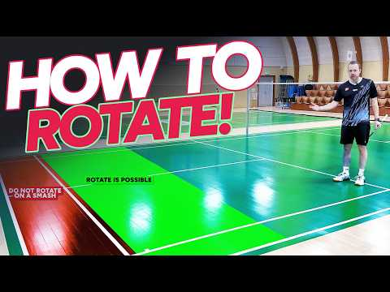](https://www.youtube.com/watch?v=A-fGBSWH4tY)

**公開免費（2026/11/15 核對）｜Badminton Famly｜教學｜內容依據 B**

| 項目 | 內容 |
|---|---|
| 技能／內容 | 發布者簡介明確列出後場進攻、後場放吊球、防守轉換三種情境，並說明以場上 2 對 2 示範與球場圖講解兩人的位置。 |
| 觀察重點 | 看片時先追蹤沒有擊球的那位搭檔：他為何移動、填補哪個空間？未取得字幕，不能把具體每一步路徑視為已核實。 |
| 建議練法 | 兩人先以半速模擬進攻前後站位、防守左右站位，再由餵球者改變來球，練習共同調整。不要預設每打一拍都必須換位。 |
| 怎樣檢查 | 每 10 次轉換記錄同搶、同讓及空檔各幾次。 |

來源：[原影片](https://www.youtube.com/watch?v=A-fGBSWH4tY) · [內容依據與觀看狀態](資料/A-fGBSWH4tY.page.json)。

### V03｜五種步法節奏練習

**公開免費（2026/11/15 核對）｜Badminton Famly｜教學｜內容依據 B**

| 項目 | 內容 |
|---|---|
| 技能／內容 | 簡介強調先慢而準確地移動，讓腿部較放鬆、節奏連貫，再建立速度；全片主題是五種節奏練習。 |
| 觀察重點 | 先觀察落地、推蹬及回位是否連續。簡介沒有逐項列出五種練習，本報不臆造其名稱或次序。 |
| 建議練法 | 選片中一種已看懂的模式，以慢速做 3 組，每組 30 秒、休息 30 秒；再加入不固定方向的口令。組數為本報建議。 |
| 怎樣檢查 | 比較同一速度下的停頓、失衡及多餘小步數，先改善品質再加快。 |

來源：[原影片](https://www.youtube.com/watch?v=uuGSSD1usG0) · [內容依據與觀看狀態](資料/uuGSSD1usG0.page.json)。

### V04｜九種可獨自練習的花式球

**公開免費（2026/11/15 核對）｜Badminton Famly｜教學｜內容依據 B**

| 項目 | 內容 |
|---|---|
| 技能／內容 | 簡介說明在反手前場角落，自行餵球練習九種變化；用途偏趣味與控拍挑戰。 |
| 觀察重點 | 先看自餵球方式、拍面及落點是否可重複；沒有字幕和完整觀看證據，因此不列九種球的詳細名稱，也不聲稱它們都是比賽最佳選擇。 |
| 建議練法 | 先挑一種能穩定自餵的變化，分別記錄自餵成功及回球入區；基本網前球穩定後再增加花式。 |
| 怎樣檢查 | 每種 10 球，分開記錄自餵成功率和目標區命中率。 |

來源：[原影片](https://www.youtube.com/watch?v=fNSZDm1B-PA) · [內容依據與觀看狀態](資料/fNSZDm1B-PA.page.json)。

### V05｜握拍：為何不應一直握緊

**公開免費（2026/11/15 核對）｜full-swing｜教學｜內容依據 B**

| 項目 | 內容 |
|---|---|
| 技能／內容 | 簡介把握拍空間、中指運用與來球速度判斷連結，並比較快速拉動與緩慢跟隨的揮拍。 |
| 觀察重點 | 6:56 章節聚焦「不是手腕」。把這當作檢查過度緊握的線索；片中等待及較低擊球點的提示有其練習情境，不是所有球都要等低。 |
| 建議練法 | 短距離輕送球，準備時讓手指可調整握柄，擊球後恢復較鬆的握拍；用相同落點比較是否更容易微調拍面。 |
| 怎樣檢查 | 20 球目標區命中數，並記錄是否能在兩拍之間恢復放鬆。 |

定位索引（發布者章節或既有字幕）：0:00 等待來球；2:57 決策；6:56 手腕與握拍。

來源：[原影片](https://www.youtube.com/watch?v=XGVuaQWXvIA) · [內容依據與觀看狀態](資料/XGVuaQWXvIA.page.json)。

### V07｜讓球拍運動：減少肩膀先推

[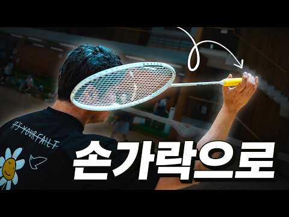](https://www.youtube.com/watch?v=wdDBn1ZqOOs)

**公開免費（2026/11/15 核對）｜full-swing｜教學｜內容依據 B**

| 項目 | 內容 |
|---|---|
| 技能／內容 | 簡介強調放鬆握拍、手指控制及身體先轉、球拍隨行，並建議在網前以慢速重複觀察球拍運動。 |
| 觀察重點 | 片名的「不要用肩膀」應理解為減少僵硬先推的教學提示，不能推論肩關節在揮拍中完全不參與。 |
| 建議練法 | 側面錄影 10 次慢揮拍，比較身體轉動、手臂與拍頭的先後；再加入輕餵球，觀察順序是否仍保留。 |
| 怎樣檢查 | 10 次中動作順序可辨識的次數，以及加入球後是否變回只用手臂。 |

定位索引（發布者章節或既有字幕）：0:00 球拍；3:35 揮拍一致性；9:55 手肘。

來源：[原影片](https://www.youtube.com/watch?v=wdDBn1ZqOOs) · [內容依據與觀看狀態](資料/wdDBn1ZqOOs.page.json)。

### V08｜身體轉動與放鬆握拍修正

**公開免費（2026/11/15 核對）｜full-swing｜教學｜內容依據 B**

| 項目 | 內容 |
|---|---|
| 技能／內容 | 簡介討論手臂與肩膀過早向前推，如何改為身體轉動帶動球拍；亦提到放鬆握拍和減少重複引拍。 |
| 觀察重點 | 先找自己的揮拍是否有「準備完成後又再引拍一次」的中斷。不要單憑某一準備姿勢的外觀判斷整個動作。 |
| 建議練法 | 無球慢揮 5 次加輕餵 5 球為一組；每組只看身體先行或重複引拍其中一項，再回看錄影。 |
| 怎樣檢查 | 20 球中重複引拍次數、擊球是否在可控制的身前區域。 |

定位索引（發布者章節或既有字幕）：2:21 放鬆握拍；6:29 身體轉動；12:34 擊球前加速；16:37 重複引拍。

來源：[原影片](https://www.youtube.com/watch?v=pzpyti1sS-I) · [內容依據與觀看狀態](資料/pzpyti1sS-I.page.json)。

### V09｜身體轉動：讓球拍完整通過

**公開免費（2026/11/15 核對）｜full-swing｜教學｜內容依據 B**

| 項目 | 內容 |
|---|---|
| 技能／內容 | 發布者章節包括手肘、較高與較低擊球點、放鬆握拍、先轉身體及揮拍完成檢查。 |
| 觀察重點 | 本片取得的是章節而非全文字幕；可據此確定主題，但不能確定每個修正口令的完整前提。 |
| 建議練法 | 慢揮與正常節奏各錄 5 次，對照準備、擊球、完成三個位置；檢查是否為了打得重而突然收緊或截斷。 |
| 怎樣檢查 | 完成動作後是否仍平衡，以及同一目標區的命中數。 |

定位索引（發布者章節或既有字幕）：4:18 握拍與拍速；6:04 身體先轉；7:07 完整通過；10:00 完成檢查。

來源：[原影片](https://www.youtube.com/watch?v=7CjvrPwg2Uk) · [內容依據與觀看狀態](資料/7CjvrPwg2Uk.page.json)。

### V11｜等待合適位置，再連貫釋放

**公開免費（2026/11/15 核對）｜full-swing｜教學｜內容依據 B**

| 項目 | 內容 |
|---|---|
| 技能／內容 | 簡介說明過遠或過高的擊球位置可能中斷此練習的揮拍，並以拍面方向、身體轉動及放鬆連接動作。 |
| 觀察重點 | 這是特定修正情境；不能因此得出羽球都應低點擊球。先確認示範的來球、距離與球路，再套用等待提示。 |
| 建議練法 | 餵球者固定落點，練習者比較過早揮、過度伸手及舒適距離三種情況；用輕球建立可重複的接觸位置。 |
| 怎樣檢查 | 20 球中擊球位置穩定次數與偏離目標區次數。 |

定位索引（發布者章節或既有字幕）：0:00 太高；3:17 超出範圍；8:14 球拍方向；10:41 如何加快。

來源：[原影片](https://www.youtube.com/watch?v=Ia7ufTADsW8) · [內容依據與觀看狀態](資料/Ia7ufTADsW8.page.json)。

### V12｜別在方向未明時搶動

**公開免費（2026/11/15 核對）｜full-swing｜教學｜內容依據 B**

| 項目 | 內容 |
|---|---|
| 技能／內容 | 簡介將過早移動與擊球點、揮拍時機失配連結，強調看清來球速度與長度，按情境調整節奏。 |
| 觀察重點 | 「等待」是避免過早猜定方向的提示；不應延伸成等到球飛近才準備，或站著不做任何調整。 |
| 建議練法 | 兩個落點隨機餵球，先判斷方向再移動；錄影比較猜錯方向與已看清仍遲到的兩種情況。 |
| 怎樣檢查 | 每 20 球猜錯方向次數、到位但出手失配次數分開記。 |

定位索引（發布者章節或既有字幕）：0:00／2:35／7:58／11:31 為發布者分段，未提供細題名。

來源：[原影片](https://www.youtube.com/watch?v=qzUQ_x-QClo) · [內容依據與觀看狀態](資料/qzUQ_x-QClo.page.json)。

### V13｜步法從正確判斷開始

**公開免費（2026/11/15 核對）｜full-swing｜教學｜內容依據 B**

| 項目 | 內容 |
|---|---|
| 技能／內容 | 簡介聚焦腳步混亂及人球距離，提出先確認方向與距離，保持準備狀態，按情境選一步、兩步或三步。 |
| 觀察重點 | 腳步快不等於到位快；觀察是否多走一步、過度衝近或來不及引拍。不要把所有來球硬套同一節奏。 |
| 建議練法 | 由近、中、遠三個餵球距離開始，先固定再隨機；每球後說出自己用了幾步及距離是否合適。 |
| 怎樣檢查 | 三種距離各 10 球，分別記錄多餘調整步及失衡次數。 |

定位索引（發布者章節或既有字幕）：1:55 步法；4:40 引拍；8:36 一、二、三步。

來源：[原影片](https://www.youtube.com/watch?v=rIuPBhoVbm4) · [內容依據與觀看狀態](資料/rIuPBhoVbm4.page.json)。

### V15｜殺球時機：從對方出球便開始觀察

[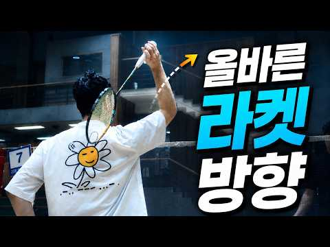](https://www.youtube.com/watch?v=vOlRQx3qF5Q)

**公開免費（2026/11/15 核對）｜full-swing｜教學｜內容依據 B**

| 項目 | 內容 |
|---|---|
| 技能／內容 | 簡介把殺球出手拖延與拍身動作順序連結，強調從球的出發位置觀察速度，調整揮拍起始。 |
| 觀察重點 | 先分清「準備太遲」和「準備很早但過早揮完」。兩者結果都可能打不好，修正方向卻不同。 |
| 建議練法 | 相同落點交替較快與較慢餵球，維持同一目標區；比較引拍開始時間，而非只盯最後接觸一刻。 |
| 怎樣檢查 | 每種速度 10 球，記錄過早、合適、過遲三類接觸。 |

定位索引（發布者章節或既有字幕）：0:00 延遲；2:38 時機；3:28 細節；9:07 拍面方向。

來源：[原影片](https://www.youtube.com/watch?v=vOlRQx3qF5Q) · [內容依據與觀看狀態](資料/vOlRQx3qF5Q.page.json)。

### V20｜關鍵分如何控制失誤（待補內容）

[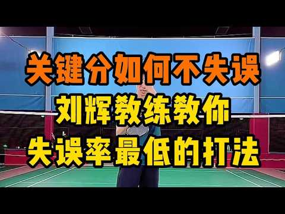](https://www.youtube.com/watch?v=tEfgBcpmznA)

**公開免費（2026/11/15 核對）｜大G羽毛球｜待補分析｜內容依據 C**

| 項目 | 內容 |
|---|---|
| 技能／內容 | 已核實標題、發布日期、頻道及時長。簡介只是重複標題，未取得可用字幕或完整影片內容，不能確認教練實際提出的低失誤打法。 |
| 觀察重點 | 待看時請記錄：所指失誤是選球還是執行？有哪些前提？有沒有示範落點與回位？暫不轉述具體口令。 |
| 建議練法 | 可先建立自己的關鍵分紀錄：分開標記出界、下網、選球後失位；此為本報獨立建議，並非影片摘要。 |
| 怎樣檢查 | 先收集自己的 20 個回合，再計算各類失誤次數；不假定任何打法能保證失誤最低。 |

來源：[原影片](https://www.youtube.com/watch?v=tEfgBcpmznA) · [內容依據與觀看狀態](資料/tEfgBcpmznA.page.json)。

### V21｜與鄭思維的訓練營紀錄

[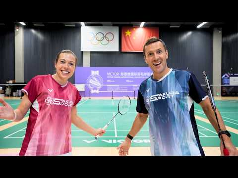](https://www.youtube.com/watch?v=37zufC7qBQs)

**公開免費（2026/11/15 核對）｜Badminton Insight｜觀摩｜內容依據 C**

| 項目 | 內容 |
|---|---|
| 技能／內容 | 標題確認與鄭思維相關的訓練營紀錄；簡介主要是課程連結。缺少可核對內容，不能把片中訓練方法、負荷或口令當作已分析。 |
| 觀察重點 | 觀察時可暫停記錄：擊球者位置、搭檔位置、來球及下一拍；先完成樣本才歸納。 |
| 建議練法 | 自行挑 10 個完整回合，畫出擊球前後站位，與雙打輪轉教學對照。這是觀摩任務，不是已完成的比賽結果。 |
| 怎樣檢查 | 記錄樣本回合及時間碼，避免只以精彩球代表全場。 |

來源：[原影片](https://www.youtube.com/watch?v=37zufC7qBQs) · [內容依據與觀看狀態](資料/37zufC7qBQs.page.json)。

### V22｜挑戰中國兩位教練

[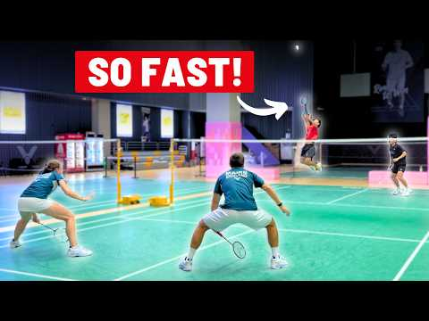](https://www.youtube.com/watch?v=6_8Widm99cE)

**公開免費（2026/11/15 核對）｜Badminton Insight｜觀摩｜內容依據 C**

| 項目 | 內容 |
|---|---|
| 技能／內容 | 標題確認是對戰挑戰；不應因簡介有教學課程廣告就歸為正式教學。未做逐球影像分析。 |
| 觀察重點 | 觀察時可暫停記錄：擊球者位置、搭檔位置、來球及下一拍；先完成樣本才歸納。 |
| 建議練法 | 自行挑 10 個完整回合，畫出擊球前後站位，與雙打輪轉教學對照。這是觀摩任務，不是已完成的比賽結果。 |
| 怎樣檢查 | 記錄樣本回合及時間碼，避免只以精彩球代表全場。 |

來源：[原影片](https://www.youtube.com/watch?v=6_8Widm99cE) · [內容依據與觀看狀態](資料/6_8Widm99cE.page.json)。

### V23｜殺球對決：高陽市廳對 Yonex

[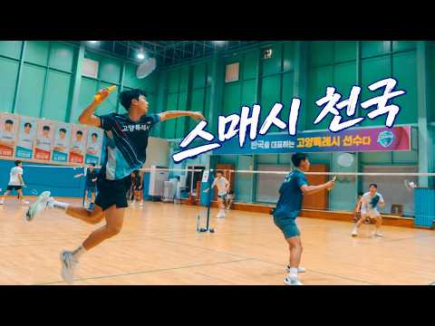](https://www.youtube.com/watch?v=OusC2RPJDQE)

**公開免費（2026/11/15 核對）｜full-swing｜觀摩｜內容依據 C**

| 項目 | 內容 |
|---|---|
| 技能／內容 | 簡介列出兩隊及三段比賽，屬對局觀摩。未取得逐球資料，不能斷定球員使用某模式的頻率或成效。 |
| 觀察重點 | 觀察時可暫停記錄：擊球者位置、搭檔位置、來球及下一拍；先完成樣本才歸納。 |
| 建議練法 | 自行挑 10 個完整回合，畫出擊球前後站位，與雙打輪轉教學對照。這是觀摩任務，不是已完成的比賽結果。 |
| 怎樣檢查 | 記錄樣本回合及時間碼，避免只以精彩球代表全場。 |

來源：[原影片](https://www.youtube.com/watch?v=OusC2RPJDQE) · [內容依據與觀看狀態](資料/OusC2RPJDQE.page.json)。

### V24｜四支進攻拍力量比較

[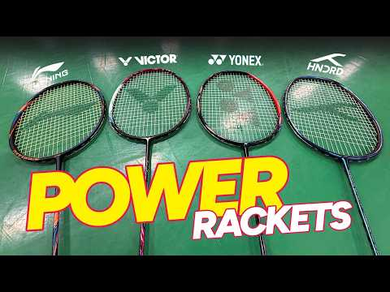](https://www.youtube.com/watch?v=xj1kb8F33Rg)

**公開免費（2026/11/15 核對）｜Badminton Famly｜器材｜內容依據 B**

| 項目 | 內容 |
|---|---|
| 技能／內容 | 簡介列出 Victor Thruster Ryuga 3、Li-Ning Axforce 90、Hundred Nitrix 80 Bullet、Yonex Astrox 77 PRO，比較力量、速度與控制。未核實測試結果，不列勝負或購買建議。 |
| 觀察重點 | 把設備與技能分開：比較前先問來球是否可重複、條件是否一致；本報不把器材測試當作技術提升證據。 |
| 建議練法 | 球拍比較可固定球、線、場地與目標；發球機可記錄設定與實際落點。這些是本報建議的比較條件。 |
| 怎樣檢查 | 記錄相同條件下的命中與偏差；本片無已核實的客觀結果可轉錄。 |

來源：[原影片](https://www.youtube.com/watch?v=xj1kb8F33Rg) · [內容依據與觀看狀態](資料/xj1kb8F33Rg.page.json)。

### V25｜與丹麥選手測試 Thruster Ryuga 3

[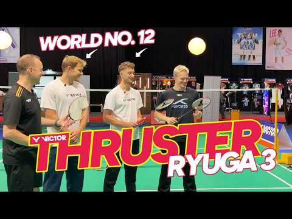](https://www.youtube.com/watch?v=Cavxva8xHEQ)

**公開免費（2026/11/15 核對）｜Badminton Famly｜器材｜內容依據 B**

| 項目 | 內容 |
|---|---|
| 技能／內容 | 簡介提及與 Mads Vestergaard、Daniel Lundgaard 討論器材選擇並測試球拍；屬器材內容。個別選手偏好不能直接代表你的適用性。 |
| 觀察重點 | 把設備與技能分開：比較前先問來球是否可重複、條件是否一致；本報不把器材測試當作技術提升證據。 |
| 建議練法 | 球拍比較可固定球、線、場地與目標；發球機可記錄設定與實際落點。這些是本報建議的比較條件。 |
| 怎樣檢查 | 記錄相同條件下的命中與偏差；本片無已核實的客觀結果可轉錄。 |

來源：[原影片](https://www.youtube.com/watch?v=Cavxva8xHEQ) · [內容依據與觀看狀態](資料/Cavxva8xHEQ.page.json)。

### V26｜TrainBot 發球機測試

[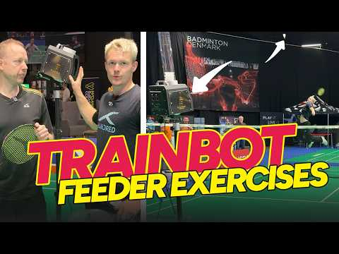](https://www.youtube.com/watch?v=cx_L7zdAeAE)

**公開免費（2026/11/15 核對）｜Badminton Famly｜器材｜內容依據 B**

| 項目 | 內容 |
|---|---|
| 技能／內容 | 簡介說明於丹麥公開賽期間測試發球機，以三種練習挑戰準確性等表現；沒有足夠內容核實各項實際成績。 |
| 觀察重點 | 把設備與技能分開：比較前先問來球是否可重複、條件是否一致；本報不把器材測試當作技術提升證據。 |
| 建議練法 | 球拍比較可固定球、線、場地與目標；發球機可記錄設定與實際落點。這些是本報建議的比較條件。 |
| 怎樣檢查 | 記錄相同條件下的命中與偏差；本片無已核實的客觀結果可轉錄。 |

來源：[原影片](https://www.youtube.com/watch?v=cx_L7zdAeAE) · [內容依據與觀看狀態](資料/cx_L7zdAeAE.page.json)。

## 4. 免費基礎補充：改看甚麼、內容怎樣調整

這兩支發布於 2021 年，為了讓學生不用會員即可學習而補入；不屬本月新片。已讀所選片段的英文字幕，未新增全片逐幀分析。

### S01｜正手、反手，換握更清楚。

[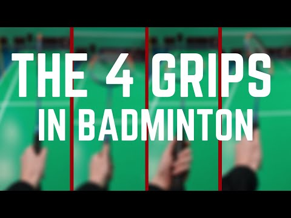](https://www.youtube.com/watch?v=toQ7tOx7Tvs&t=22s)

**[免費片段 0:22–1:40｜正手與反手握拍](https://www.youtube.com/watch?v=toQ7tOx7Tvs&t=22s)｜Badminton Insight｜2021 年基礎補充**

先對照示範認清正手、反手的握法和拍面方向，再慢慢練習換握。這次只處理握法，不追求發力。

- **準備：** 分別對照正手、反手示範，拍面方向是否跟你預期一致？

- **擊球：** 用輕球練習時，換握後能否把球送向同一個目標？

- **下一拍：** 球換到另一側時，能否及時改用合適握法，而不是一直握同一面？

**適用提醒：** 這段拇指反手握法用於發球、平抽和雙打防守，不要直接套在後場反手。先用近距離輕球練。

**練法：** 對照影片，分別擺出正手和反手握拍。 不用打球，慢慢換握 10 次，看拍面能否調整到想要的方向。 請同學近距離輕輕送球；正手、反手各打 10 球，分開記錄。

**檢查：** 正手、反手各 10 球，分開記偏離目標的球數。下次用相同目標再試。

[來源核對紀錄](資料/toQ7tOx7Tvs.replacement_source.json)。

### S02｜正手後場：側身、換腳、回位。

[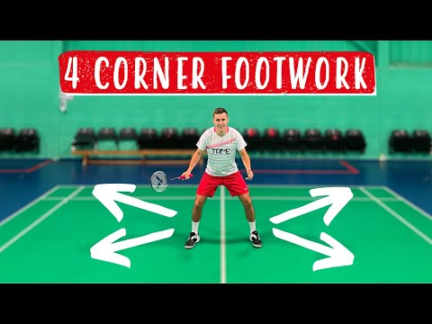](https://www.youtube.com/watch?v=fBa08o5GEqw&t=267s)

**[免費片段 4:27–6:04｜正手後場步法](https://www.youtube.com/watch?v=fBa08o5GEqw&t=267s)｜Badminton Insight｜2021 年基礎補充**

片段示範正手後場的剪刀步換腳動作。先看側身準備，再看轉身、落地與回位；這只是後場移動的一種方式。

- **準備：** 示範先側身到位，避免一直正面朝網再勉強大幅扭轉。

- **擊球：** 留意持拍側腿推蹬、身體轉動與換腳的連接，不只盯著球拍。

- **下一拍：** 落地時兩腳保留距離，保持平衡，再接回下一拍準備。

**適用提醒：** 片段包含換腳跳。先看懂動作再按自己的程度練；持拍側不同要鏡像理解，也不要把所有後場球都套同一種步法。

**練法：** 先對照示範，在教練指導下慢速練側身和換腳動作。 再接固定正手後場高球 10 球，留意擊球後能否移向場內。 記下有幾球能平衡回位，下次用相同落點再試。

**檢查：** 每 10 球，只記打完後能平衡回位的球數；先不用追求速度。

[來源核對紀錄](資料/fBa08o5GEqw.replacement_source.json)。

## 5. 已移出學生推薦的會員影片

以下七支確認屬會員專屬；本版不提供播放按鈕或推薦路徑。保留標題和原代碼作為修訂紀錄，不再引導學生觀看或付費。

| 原編號 | 影片 | 處理 |
|---|---|---|
| V06 | 用手指形成自然揮拍 | 會員專屬，已移出學生推薦 |
| V10 | 殺球修正：軀幹轉動與拍頭 | 會員專屬，已移出學生推薦 |
| V14 | 殺球步法與時機修正 | 會員專屬，已移出學生推薦 |
| V16 | 等待擊球點：同步揮拍與步法 | 會員專屬，已移出學生推薦 |
| V17 | 等待、引拍與步法綜合修正 | 會員專屬，已移出學生推薦 |
| V18 | 揮拍與步法：讀取並建立擊球時機 | 會員專屬，已移出學生推薦 |
| V19 | 網前控制、殺球變化與進攻輪轉 | 會員專屬，已移出學生推薦 |

## 6. 把免費重點變成練習

先用固定來球做得準，再改一個速度或落點，最後放入短回合。時間與球數是整理建議，不是國際級選手資格或技能達標標準。

| 日期／細節 | 條件 | 第一組 | 第二組 | 下次只改一項 |
|---|---|---|---|---|
| 待填 | 同目標／同落點；固定或變化要註明 |  |  |  |

## 7. 範圍與核對紀錄

原月報 26 支及補充候選 3 支，共 29 支；另核對科技頁的 31 支不同影片。整站共檢查 60 支不同影片，53 支可免費公開播放、7 支會員專屬。只以未登入播放器的明確狀態與串流可用性判定；沒有把影片 HTTP 200 或頻道「加入」按鈕當成會員判斷。原 26 支中 19 支免費、7 支會員；補充 3 支均免費，精華採用其中 2 支。權限日後或不同地區可能改變。

原月報檢索仍不是 YouTube 全站完整收錄。原分類曾使用 Jev 輔助並人工複核；這次免費／會員核對直接依 YouTube 播放器狀態與會員專屬提示，沒有用 Jev 猜測。

[全部觀看權限核對表](影片免費觀看檢查_20261115.md) · [原始核對 JSON](資料/影片觀看權限核對_20261115.json) · [檢索稽核](資料/檢索稽核.json) · [學習口袋卡](圖片/05_學習口袋卡.png?v=free-20261115)

原影片與縮圖權利屬原創作者；自製示意圖是學習整理，並非影片畫面量測。本頁不提供影片本體、不要求購買課程，也沒有建立每月自動更新。
