# YouTube 羽球教學月報｜2026 年 11 月

> **時間有限？先看 [高效學習精華版](羽球教學_高效學習精華版.md)：五個重點、指定短片段和一項一項練習。**

**收錄期間：2026/10/16–2026/11/15｜日期統一換算澳門時間（UTC+8）｜編製日：2026/11/15**

> 本期為可核實來源的檢索月報，不是 YouTube 全站完整清單。已整理 26 支期間內影片：19 支有足夠資料作教學分析、1 支待補內容、3 支觀摩、3 支器材。分析深度取決於來源可用性，並未逐支完整觀看。影片以原 YouTube 連結與本地縮圖保存，沒有下載影片本體。

## 1. 本月怎樣學最有效

本期可核實的教學內容，集中在**握拍與手指 → 揮拍協調 → 擊球時機與步法 → 雙打輪轉及選球**。這是本期樣本的共同主題，不代表整個 YouTube 或羽球教學的流行趨勢。來源中 full-swing 比例較高，其相近修正提示宜挑選對照，不必全部連續看。

先選一個會反覆出現的問題，按下表選兩支影片；看完立即用固定條件練習，再用變化來球檢查。報告內的組數、指標、學習次序與關聯圖均為本報編製，並非影片宣稱或已證實的訓練成效。

| 你遇到的問題 | 建議先看 | 看片要抓的技能 | 實際檢查 |
|---|---|---|---|
| 握得很緊、拍面難控制 | V05 → V06 | 握柄空間、手指換握與拍面 | 相同目標 20 球，記方向失控 |
| 感覺很用力，出球仍不穩 | V08 → V10 | 身體、手臂與拍頭的協調 | 比較命中與主觀用力 |
| 經常追球或伸手勉強擊球 | V11 → V16 | 人球距離與出手時機 | 分開記過早、太遠、太遲 |
| 步法練很多，實際仍亂 | V03 → V13 → V14 | 讀球、步數、最後一步平衡 | 固定球和隨機球分開記 |
| 雙打同搶、同讓、漏空檔 | V01 → V02 → V19 | 無球者補位、攻守轉換 | 每 10 輪記責任不清次數 |
| 想練獨自控拍 | V04 | 反手前場自餵與拍面控制 | 先把自餵和擊球成功分開 |

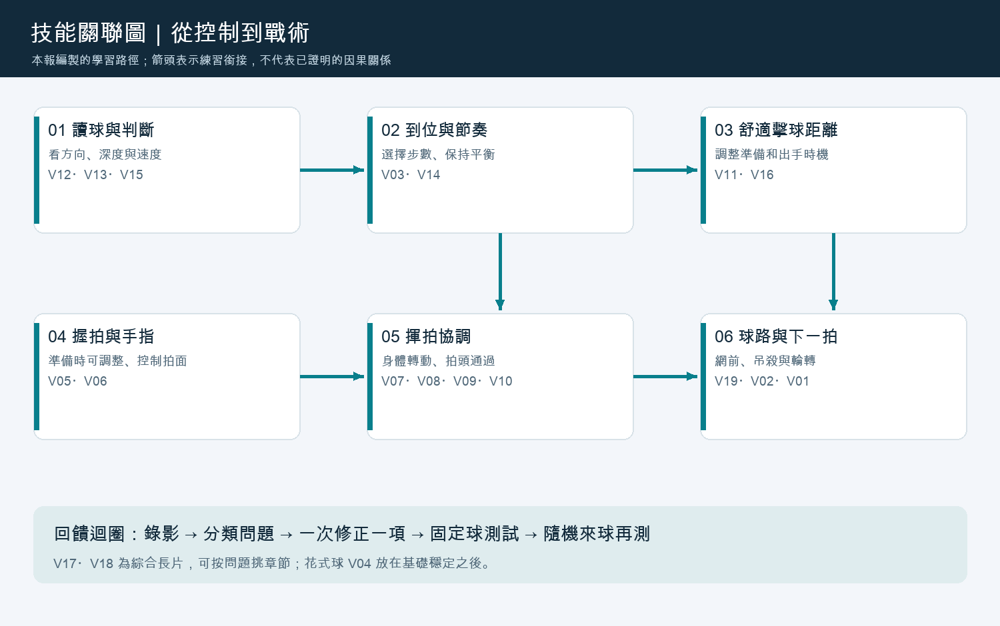

## 2. 資料可信程度與閱讀方式

| 標記 | 本報實際取得的資料 | 可以支持甚麼 | 限制 |
|---|---|---|---|
| A | 全段可讀字幕及影片資料（本期僅 V01） | 內容摘要及可追查的時間段 | 字幕可能出錯；未做逐幀動作量測 |
| B | 發布者簡介及／或章節 | 影片明確列出的主題、修正方向 | 不是全片逐段分析；沒有字幕的細節不補寫 |
| C | 標題／基本資料，或觀摩但缺少可核對內容 | 影片索引、待看問題 | 不能據此聲稱教練實際教了某個方法 |

每支影片的「內容與技能」根據來源；「分析／觀察重點」包含本報解讀；「建議練法／檢查」是獨立編製。時間碼來自字幕或發布者章節；沒有來源支持的時間碼不會補造。原音語言不等於標題語言：full-swing 的內容主要為韓語，英語標題也不保證全片有英文字幕；可在 YouTube 播放器檢查當時可用的字幕。

## 3. 全部影片快速索引

| 編號 | 日期（澳門） | 影片／技能 | 頻道 | 時長 | 類型／依據 |
|---|---|---|---|---|---|
| [V01](#v01) | 2026-10-25 | [單打與雙打：十項差異](https://www.youtube.com/watch?v=8GAmxmLXc70) 選球、站位與搭檔配合 | Badminton Insight | 10:51 | 教學／A |
| [V02](#v02) | 2026-10-16 | [雙打輪轉：三種基本模式](https://www.youtube.com/watch?v=A-fGBSWH4tY) 進攻、防守與轉換 | Badminton Famly | 7:17 | 教學／B |
| [V03](#v03) | 2026-10-27 | [五種步法節奏練習](https://www.youtube.com/watch?v=uuGSSD1usG0) 移動節奏與平衡 | Badminton Famly | 10:20 | 教學／B |
| [V04](#v04) | 2026-11-07 | [九種可獨自練習的花式球](https://www.youtube.com/watch?v=fNSZDm1B-PA) 反手前場控拍與變化 | Badminton Famly | 4:34 | 教學／B |
| [V05](#v05) | 2026-11-02 | [握拍：為何不應一直握緊](https://www.youtube.com/watch?v=XGVuaQWXvIA) 握拍空間與手指控制 | full-swing | 10:22 | 教學／B |
| [V06](#v06) | 2026-11-06 | [用手指形成自然揮拍](https://www.youtube.com/watch?v=jwKZsDfNR6E) 手指分工與拍面控制 | full-swing | 12:50 | 教學／B |
| [V07](#v07) | 2026-10-30 | [讓球拍運動：減少肩膀先推](https://www.youtube.com/watch?v=wdDBn1ZqOOs) 揮拍順序與拍頭運動 | full-swing | 14:23 | 教學／B |
| [V08](#v08) | 2026-10-25 | [身體轉動與放鬆握拍修正](https://www.youtube.com/watch?v=pzpyti1sS-I) 軀幹先行、連貫加速 | full-swing | 18:36 | 教學／B |
| [V09](#v09) | 2026-11-11 | [身體轉動：讓球拍完整通過](https://www.youtube.com/watch?v=7CjvrPwg2Uk) 放鬆與揮拍完成 | full-swing | 10:48 | 教學／B |
| [V10](#v10) | 2026-11-05 | [殺球修正：軀幹轉動與拍頭](https://www.youtube.com/watch?v=Qk8SNvKcX0Q) 殺球協調與擊球感 | full-swing | 12:07 | 教學／B |
| [V11](#v11) | 2026-11-13 | [等待合適位置，再連貫釋放](https://www.youtube.com/watch?v=Ia7ufTADsW8) 擊球距離與出手時機 | full-swing | 13:45 | 教學／B |
| [V12](#v12) | 2026-10-27 | [別在方向未明時搶動](https://www.youtube.com/watch?v=qzUQ_x-QClo) 讀球、踩步與揮拍同步 | full-swing | 13:14 | 教學／B |
| [V13](#v13) | 2026-11-09 | [步法從正確判斷開始](https://www.youtube.com/watch?v=rIuPBhoVbm4) 讀球距離與步數選擇 | full-swing | 11:27 | 教學／B |
| [V14](#v14) | 2026-11-05 | [殺球步法與時機修正](https://www.youtube.com/watch?v=1U4Wtnk4pT8) 後退平衡、步幅與轉身 | full-swing | 12:49 | 教學／B |
| [V15](#v15) | 2026-11-05 | [殺球時機：從對方出球便開始觀察](https://www.youtube.com/watch?v=vOlRQx3qF5Q) 來球速度與引拍節奏 | full-swing | 16:38 | 教學／B |
| [V16](#v16) | 2026-11-05 | [等待擊球點：同步揮拍與步法](https://www.youtube.com/watch?v=EU7zW_yTElc) 人球距離、身體與手臂順序 | full-swing | 12:28 | 教學／B |
| [V17](#v17) | 2026-11-03 | [等待、引拍與步法綜合修正](https://www.youtube.com/watch?v=Rh0hy-ToyeU) 依來球調整整體節奏 | full-swing | 39:42 | 教學／B |
| [V18](#v18) | 2026-11-01 | [揮拍與步法：讀取並建立擊球時機](https://www.youtube.com/watch?v=bQ6ns6Ychoo) 讀球、準備與連續回位 | full-swing | 37:51 | 教學／B |
| [V19](#v19) | 2026-11-05 | [網前控制、殺球變化與進攻輪轉](https://www.youtube.com/watch?v=lA6RTlaN5Os) 前後場銜接與變速 | full-swing | 12:53 | 教學／B |
| [V20](#v20) | 2026-11-15 | [關鍵分如何控制失誤（待補內容）](https://www.youtube.com/watch?v=tEfgBcpmznA) 單打風險選擇（僅標題確認） | 大G羽毛球 | 3:30 | 待補分析／C |
| [V21](#v21) | 2026-11-01 | [與鄭思維的訓練營紀錄](https://www.youtube.com/watch?v=37zufC7qBQs) 訓練觀摩 | Badminton Insight | 10:49 | 觀摩／C |
| [V22](#v22) | 2026-11-08 | [挑戰中國兩位教練](https://www.youtube.com/watch?v=6_8Widm99cE) 對戰觀摩 | Badminton Insight | 10:14 | 觀摩／C |
| [V23](#v23) | 2026-11-04 | [殺球對決：高陽市廳對 Yonex](https://www.youtube.com/watch?v=OusC2RPJDQE) 比賽觀摩 | full-swing | 12:30 | 觀摩／C |
| [V24](#v24) | 2026-11-13 | [四支進攻拍力量比較](https://www.youtube.com/watch?v=xj1kb8F33Rg) 器材／訓練工具 | Badminton Famly | 10:45 | 器材／B |
| [V25](#v25) | 2026-10-23 | [與丹麥選手測試 Thruster Ryuga 3](https://www.youtube.com/watch?v=Cavxva8xHEQ) 器材／訓練工具 | Badminton Famly | 10:03 | 器材／B |
| [V26](#v26) | 2026-10-31 | [TrainBot 發球機測試](https://www.youtube.com/watch?v=cx_L7zdAeAE) 器材／訓練工具 | Badminton Famly | 6:46 | 器材／B |

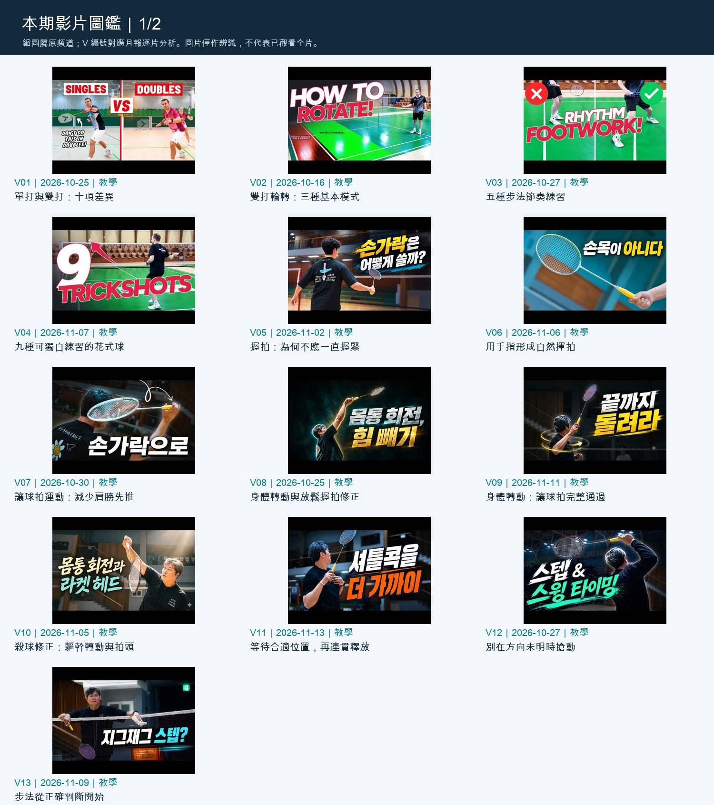

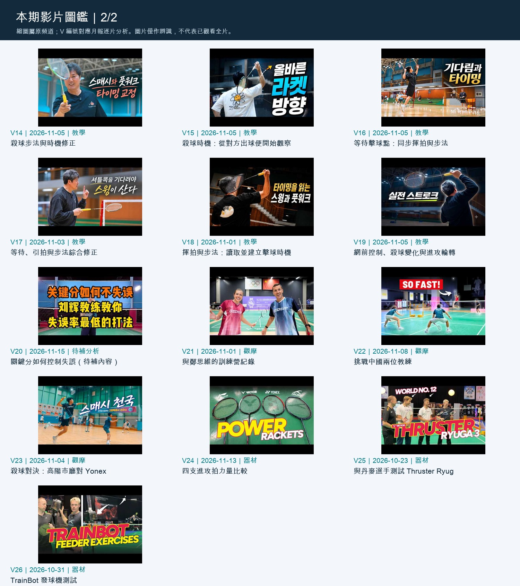

## 4. 逐片技能分析

### V01｜單打與雙打：十項差異

[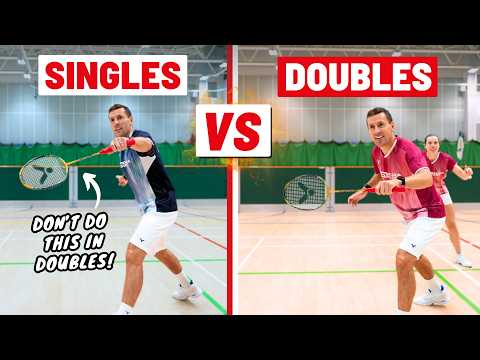](https://www.youtube.com/watch?v=8GAmxmLXc70)

**[觀看原片](https://www.youtube.com/watch?v=8GAmxmLXc70)｜Badminton Insight｜2026-10-25｜10:51｜教學｜依據 A**

原題：Singles vs Doubles: 10 Differences You NEED To Know

**強調技能：選球、站位與搭檔配合**。標籤：戰術、輪轉、步法。

| 分析項目 | 內容 |
|---|---|
| 內容與技能 | 影片從策略、站位和球路比較單雙打。單打利用大範圍空檔；雙打也要找兩人之間及輪轉中的責任模糊區。雙打站位隨搭檔移動而調整，沒有固定中央基地。 |
| 分析／觀察重點 | 重點不是記住十句口訣，而是判斷同一球路在不同項目是否仍有效。留意雙打未接球時仍要調整位置，以及防守準備拍位的情境差異。 |
| 建議練法（本報編製） | 雙打只打前四拍：發球、接發、第三拍、第四拍後停止。每輪先約定第三拍由誰處理，再以不同接發方向重做。這是報告建議的改編練習。 |
| 檢查方法（本報編製） | 記錄 10 輪中責任不清次數、第四拍後是否仍有明顯空檔；與自己的第一週基線比較。 |

**定位重點：** [0:42 策略差異](https://www.youtube.com/watch?v=8GAmxmLXc70&t=42s)；[2:38 前四拍](https://www.youtube.com/watch?v=8GAmxmLXc70&t=158s)；[4:18 站位](https://www.youtube.com/watch?v=8GAmxmLXc70&t=258s)；[6:59 網前](https://www.youtube.com/watch?v=8GAmxmLXc70&t=419s)；[8:44 防守](https://www.youtube.com/watch?v=8GAmxmLXc70&t=524s)；[9:25 後場](https://www.youtube.com/watch?v=8GAmxmLXc70&t=565s)。

來源：[Badminton Insight 原影片頁面及其發布資料](https://www.youtube.com/watch?v=8GAmxmLXc70)。本次保存的[來源資料](資料/8GAmxmLXc70.page.json)。

### V02｜雙打輪轉：三種基本模式

**[觀看原片](https://www.youtube.com/watch?v=A-fGBSWH4tY)｜Badminton Famly｜2026-10-16｜7:17｜教學｜依據 B**

原題：Badminton Doubles Rotation Explained (3 Essential Patterns)

**強調技能：進攻、防守與轉換**。標籤：輪轉、戰術。

| 分析項目 | 內容 |
|---|---|
| 內容與技能 | 發布者簡介明確列出後場進攻、後場放吊球、防守轉換三種情境，並說明以場上 2 對 2 示範與球場圖講解兩人的位置。 |
| 分析／觀察重點 | 看片時先追蹤沒有擊球的那位搭檔：他為何移動、填補哪個空間？未取得字幕，不能把具體每一步路徑視為已核實。 |
| 建議練法（本報編製） | 兩人先以半速模擬進攻前後站位、防守左右站位，再由餵球者改變來球，練習共同調整。不要預設每打一拍都必須換位。 |
| 檢查方法（本報編製） | 每 10 次轉換記錄同搶、同讓及空檔各幾次。 |

來源：[Badminton Famly 原影片頁面及其發布資料](https://www.youtube.com/watch?v=A-fGBSWH4tY)。本次保存的[來源資料](資料/A-fGBSWH4tY.page.json)。

### V03｜五種步法節奏練習

[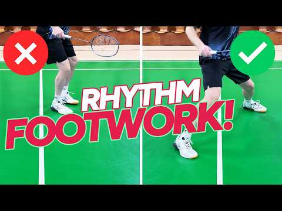](https://www.youtube.com/watch?v=uuGSSD1usG0)

**[觀看原片](https://www.youtube.com/watch?v=uuGSSD1usG0)｜Badminton Famly｜2026-10-27｜10:20｜教學｜依據 B**

原題：Master Badminton Footwork: 5 Rhythm Exercises for Smooth Movement

**強調技能：移動節奏與平衡**。標籤：步法、時機。

| 分析項目 | 內容 |
|---|---|
| 內容與技能 | 簡介強調先慢而準確地移動，讓腿部較放鬆、節奏連貫，再建立速度；全片主題是五種節奏練習。 |
| 分析／觀察重點 | 先觀察落地、推蹬及回位是否連續。簡介沒有逐項列出五種練習，本報不臆造其名稱或次序。 |
| 建議練法（本報編製） | 選片中一種已看懂的模式，以慢速做 3 組，每組 30 秒、休息 30 秒；再加入不固定方向的口令。組數為本報建議。 |
| 檢查方法（本報編製） | 比較同一速度下的停頓、失衡及多餘小步數，先改善品質再加快。 |

來源：[Badminton Famly 原影片頁面及其發布資料](https://www.youtube.com/watch?v=uuGSSD1usG0)。本次保存的[來源資料](資料/uuGSSD1usG0.page.json)。

### V04｜九種可獨自練習的花式球

[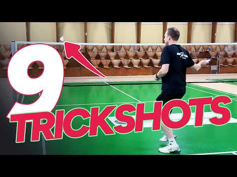](https://www.youtube.com/watch?v=fNSZDm1B-PA)

**[觀看原片](https://www.youtube.com/watch?v=fNSZDm1B-PA)｜Badminton Famly｜2026-11-07｜4:34｜教學｜依據 B**

原題：9 Badminton Trick Shots You Can Train ALONE! 🤯

**強調技能：反手前場控拍與變化**。標籤：手指、網前。

| 分析項目 | 內容 |
|---|---|
| 內容與技能 | 簡介說明在反手前場角落，自行餵球練習九種變化；用途偏趣味與控拍挑戰。 |
| 分析／觀察重點 | 先看自餵球方式、拍面及落點是否可重複；沒有字幕和完整觀看證據，因此不列九種球的詳細名稱，也不聲稱它們都是比賽最佳選擇。 |
| 建議練法（本報編製） | 先挑一種能穩定自餵的變化，分別記錄自餵成功及回球入區；基本網前球穩定後再增加花式。 |
| 檢查方法（本報編製） | 每種 10 球，分開記錄自餵成功率和目標區命中率。 |

來源：[Badminton Famly 原影片頁面及其發布資料](https://www.youtube.com/watch?v=fNSZDm1B-PA)。本次保存的[來源資料](資料/fNSZDm1B-PA.page.json)。

### V05｜握拍：為何不應一直握緊

[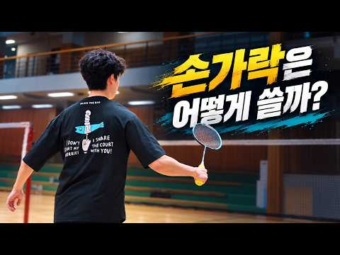](https://www.youtube.com/watch?v=XGVuaQWXvIA)

**[觀看原片](https://www.youtube.com/watch?v=XGVuaQWXvIA)｜full-swing｜2026-11-02｜10:22｜教學｜依據 B**

原題：Badminton Grip: Why You Shouldn’t Squeeze the Racket

**強調技能：握拍空間與手指控制**。標籤：手指、時機。

| 分析項目 | 內容 |
|---|---|
| 內容與技能 | 簡介把握拍空間、中指運用與來球速度判斷連結，並比較快速拉動與緩慢跟隨的揮拍。 |
| 分析／觀察重點 | 6:56 章節聚焦「不是手腕」。把這當作檢查過度緊握的線索；片中等待及較低擊球點的提示有其練習情境，不是所有球都要等低。 |
| 建議練法（本報編製） | 短距離輕送球，準備時讓手指可調整握柄，擊球後恢復較鬆的握拍；用相同落點比較是否更容易微調拍面。 |
| 檢查方法（本報編製） | 20 球目標區命中數，並記錄是否能在兩拍之間恢復放鬆。 |

**定位重點：** [0:00 等待來球](https://www.youtube.com/watch?v=XGVuaQWXvIA&t=0s)；[2:57 決策](https://www.youtube.com/watch?v=XGVuaQWXvIA&t=177s)；[6:56 手腕與握拍](https://www.youtube.com/watch?v=XGVuaQWXvIA&t=416s)。

來源：[full-swing 原影片頁面及其發布資料](https://www.youtube.com/watch?v=XGVuaQWXvIA)。本次保存的[來源資料](資料/XGVuaQWXvIA.page.json)。

### V06｜用手指形成自然揮拍

[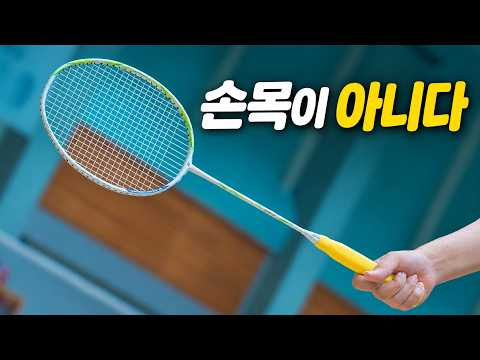](https://www.youtube.com/watch?v=jwKZsDfNR6E)

**[觀看原片](https://www.youtube.com/watch?v=jwKZsDfNR6E)｜full-swing｜2026-11-06｜12:50｜教學｜依據 B**

原題：🏸 Creating a Natural Swing with Your Fingers, Not Your Wrist

**強調技能：手指分工與拍面控制**。標籤：手指、揮拍。

| 分析項目 | 內容 |
|---|---|
| 內容與技能 | 簡介分配拇指、食指的方向控制與其餘手指的輔助出力，並討論前後手的手臂轉動，避免刻意折腕。 |
| 分析／觀察重點 | 注意「手指分工」如何隨正反手與球路變化。這是教學提示，不是本報以影像量測得到的手指受力數據。 |
| 建議練法（本報編製） | 先做慢速正反手換拍面，再做短距離平抽，保持小幅度並比較方向控制；一次只修正一個握拍問題。 |
| 檢查方法（本報編製） | 連續 20 球的拍面失控次數及成功換握次數。 |

**定位重點：** [1:33 拇指與食指](https://www.youtube.com/watch?v=jwKZsDfNR6E&t=93s)；[4:42 握拍時機](https://www.youtube.com/watch?v=jwKZsDfNR6E&t=282s)；[7:24 正反手控制](https://www.youtube.com/watch?v=jwKZsDfNR6E&t=444s)；[9:42 初學修正](https://www.youtube.com/watch?v=jwKZsDfNR6E&t=582s)。

來源：[full-swing 原影片頁面及其發布資料](https://www.youtube.com/watch?v=jwKZsDfNR6E)。本次保存的[來源資料](資料/jwKZsDfNR6E.page.json)。

### V07｜讓球拍運動：減少肩膀先推

**[觀看原片](https://www.youtube.com/watch?v=wdDBn1ZqOOs)｜full-swing｜2026-10-30｜14:23｜教學｜依據 B**

原題：Racket Swing: Let the Racket Move, Not the Shoulder

**強調技能：揮拍順序與拍頭運動**。標籤：揮拍、手指。

| 分析項目 | 內容 |
|---|---|
| 內容與技能 | 簡介強調放鬆握拍、手指控制及身體先轉、球拍隨行，並建議在網前以慢速重複觀察球拍運動。 |
| 分析／觀察重點 | 片名的「不要用肩膀」應理解為減少僵硬先推的教學提示，不能推論肩關節在揮拍中完全不參與。 |
| 建議練法（本報編製） | 側面錄影 10 次慢揮拍，比較身體轉動、手臂與拍頭的先後；再加入輕餵球，觀察順序是否仍保留。 |
| 檢查方法（本報編製） | 10 次中動作順序可辨識的次數，以及加入球後是否變回只用手臂。 |

**定位重點：** [0:00 球拍](https://www.youtube.com/watch?v=wdDBn1ZqOOs&t=0s)；[3:35 揮拍一致性](https://www.youtube.com/watch?v=wdDBn1ZqOOs&t=215s)；[9:55 手肘](https://www.youtube.com/watch?v=wdDBn1ZqOOs&t=595s)。

來源：[full-swing 原影片頁面及其發布資料](https://www.youtube.com/watch?v=wdDBn1ZqOOs)。本次保存的[來源資料](資料/wdDBn1ZqOOs.page.json)。

### V08｜身體轉動與放鬆握拍修正

**[觀看原片](https://www.youtube.com/watch?v=pzpyti1sS-I)｜full-swing｜2026-10-25｜18:36｜教學｜依據 B**

原題：🏸 Badminton Swing Correction: Torso Rotation and Relaxing Your Grip

**強調技能：軀幹先行、連貫加速**。標籤：揮拍、手指。

| 分析項目 | 內容 |
|---|---|
| 內容與技能 | 簡介討論手臂與肩膀過早向前推，如何改為身體轉動帶動球拍；亦提到放鬆握拍和減少重複引拍。 |
| 分析／觀察重點 | 先找自己的揮拍是否有「準備完成後又再引拍一次」的中斷。不要單憑某一準備姿勢的外觀判斷整個動作。 |
| 建議練法（本報編製） | 無球慢揮 5 次加輕餵 5 球為一組；每組只看身體先行或重複引拍其中一項，再回看錄影。 |
| 檢查方法（本報編製） | 20 球中重複引拍次數、擊球是否在可控制的身前區域。 |

**定位重點：** [2:21 放鬆握拍](https://www.youtube.com/watch?v=pzpyti1sS-I&t=141s)；[6:29 身體轉動](https://www.youtube.com/watch?v=pzpyti1sS-I&t=389s)；[12:34 擊球前加速](https://www.youtube.com/watch?v=pzpyti1sS-I&t=754s)；[16:37 重複引拍](https://www.youtube.com/watch?v=pzpyti1sS-I&t=997s)。

來源：[full-swing 原影片頁面及其發布資料](https://www.youtube.com/watch?v=pzpyti1sS-I)。本次保存的[來源資料](資料/pzpyti1sS-I.page.json)。

### V09｜身體轉動：讓球拍完整通過

[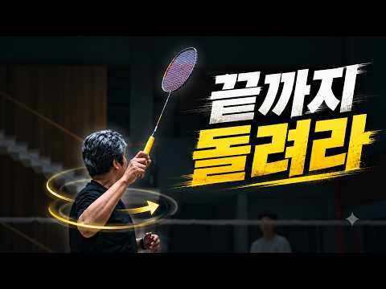](https://www.youtube.com/watch?v=7CjvrPwg2Uk)

**[觀看原片](https://www.youtube.com/watch?v=7CjvrPwg2Uk)｜full-swing｜2026-11-11｜10:48｜教學｜依據 B**

原題：Body Rotation: Let the Racket Swing Through

**強調技能：放鬆與揮拍完成**。標籤：揮拍、手指。

| 分析項目 | 內容 |
|---|---|
| 內容與技能 | 發布者章節包括手肘、較高與較低擊球點、放鬆握拍、先轉身體及揮拍完成檢查。 |
| 分析／觀察重點 | 本片取得的是章節而非全文字幕；可據此確定主題，但不能確定每個修正口令的完整前提。 |
| 建議練法（本報編製） | 慢揮與正常節奏各錄 5 次，對照準備、擊球、完成三個位置；檢查是否為了打得重而突然收緊或截斷。 |
| 檢查方法（本報編製） | 完成動作後是否仍平衡，以及同一目標區的命中數。 |

**定位重點：** [4:18 握拍與拍速](https://www.youtube.com/watch?v=7CjvrPwg2Uk&t=258s)；[6:04 身體先轉](https://www.youtube.com/watch?v=7CjvrPwg2Uk&t=364s)；[7:07 完整通過](https://www.youtube.com/watch?v=7CjvrPwg2Uk&t=427s)；[10:00 完成檢查](https://www.youtube.com/watch?v=7CjvrPwg2Uk&t=600s)。

來源：[full-swing 原影片頁面及其發布資料](https://www.youtube.com/watch?v=7CjvrPwg2Uk)。本次保存的[來源資料](資料/7CjvrPwg2Uk.page.json)。

### V10｜殺球修正：軀幹轉動與拍頭

[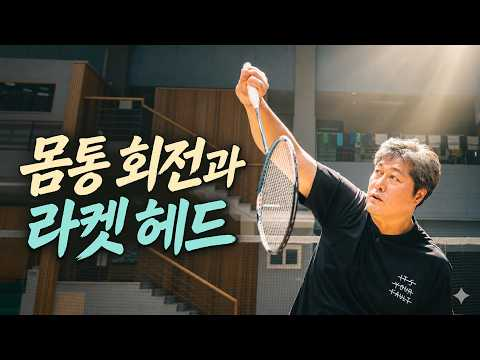](https://www.youtube.com/watch?v=Qk8SNvKcX0Q)

**[觀看原片](https://www.youtube.com/watch?v=Qk8SNvKcX0Q)｜full-swing｜2026-11-05｜12:07｜教學｜依據 B**

原題：🏸 Fix Your Smash: Effortless Power Through Core Rotation and the Racket Head

**強調技能：殺球協調與擊球感**。標籤：揮拍、時機、手指。

| 分析項目 | 內容 |
|---|---|
| 內容與技能 | 簡介以身體先轉、拍頭自然通過及握拍調整，修正肩臂用力推球；章節亦討論不刻意扭腕與輕觸下的準確擊球。 |
| 分析／觀察重點 | 別把「省力」理解為完全不用力；先觀察是否能減少多餘緊張，再比較相同主觀用力下的落點和出球品質。 |
| 建議練法（本報編製） | 以中等力度打固定區 3 組，每組 10 球；每組只修正握拍、身體順序或拍頭路徑其中一項。 |
| 檢查方法（本報編製） | 固定區命中數、下網數及每組主觀用力感；不以聲音代替球速。 |

**定位重點：** [0:00 軀幹帶動](https://www.youtube.com/watch?v=Qk8SNvKcX0Q&t=0s)；[7:07 握拍](https://www.youtube.com/watch?v=Qk8SNvKcX0Q&t=427s)；[9:53 避免刻意轉腕](https://www.youtube.com/watch?v=Qk8SNvKcX0Q&t=593s)；[11:14 準確擊球](https://www.youtube.com/watch?v=Qk8SNvKcX0Q&t=674s)。

來源：[full-swing 原影片頁面及其發布資料](https://www.youtube.com/watch?v=Qk8SNvKcX0Q)。本次保存的[來源資料](資料/Qk8SNvKcX0Q.page.json)。

### V11｜等待合適位置，再連貫釋放

[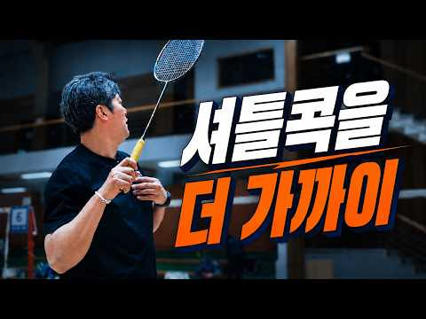](https://www.youtube.com/watch?v=Ia7ufTADsW8)

**[觀看原片](https://www.youtube.com/watch?v=Ia7ufTADsW8)｜full-swing｜2026-11-13｜13:45｜教學｜依據 B**

原題：Full Swing: Hold the Power, Release It Once

**強調技能：擊球距離與出手時機**。標籤：時機、揮拍。

| 分析項目 | 內容 |
|---|---|
| 內容與技能 | 簡介說明過遠或過高的擊球位置可能中斷此練習的揮拍，並以拍面方向、身體轉動及放鬆連接動作。 |
| 分析／觀察重點 | 這是特定修正情境；不能因此得出羽球都應低點擊球。先確認示範的來球、距離與球路，再套用等待提示。 |
| 建議練法（本報編製） | 餵球者固定落點，練習者比較過早揮、過度伸手及舒適距離三種情況；用輕球建立可重複的接觸位置。 |
| 檢查方法（本報編製） | 20 球中擊球位置穩定次數與偏離目標區次數。 |

**定位重點：** [0:00 太高](https://www.youtube.com/watch?v=Ia7ufTADsW8&t=0s)；[3:17 超出範圍](https://www.youtube.com/watch?v=Ia7ufTADsW8&t=197s)；[8:14 球拍方向](https://www.youtube.com/watch?v=Ia7ufTADsW8&t=494s)；[10:41 如何加快](https://www.youtube.com/watch?v=Ia7ufTADsW8&t=641s)。

來源：[full-swing 原影片頁面及其發布資料](https://www.youtube.com/watch?v=Ia7ufTADsW8)。本次保存的[來源資料](資料/Ia7ufTADsW8.page.json)。

### V12｜別在方向未明時搶動

**[觀看原片](https://www.youtube.com/watch?v=qzUQ_x-QClo)｜full-swing｜2026-10-27｜13:14｜教學｜依據 B**

原題：Badminton Timing: Don't Move Before the Shuttle

**強調技能：讀球、踩步與揮拍同步**。標籤：時機、步法。

| 分析項目 | 內容 |
|---|---|
| 內容與技能 | 簡介將過早移動與擊球點、揮拍時機失配連結，強調看清來球速度與長度，按情境調整節奏。 |
| 分析／觀察重點 | 「等待」是避免過早猜定方向的提示；不應延伸成等到球飛近才準備，或站著不做任何調整。 |
| 建議練法（本報編製） | 兩個落點隨機餵球，先判斷方向再移動；錄影比較猜錯方向與已看清仍遲到的兩種情況。 |
| 檢查方法（本報編製） | 每 20 球猜錯方向次數、到位但出手失配次數分開記。 |

**定位重點：** [0:00 ／2:35／7:58／11:31 為發布者分段，未提供細題名](https://www.youtube.com/watch?v=qzUQ_x-QClo&t=0s)。

來源：[full-swing 原影片頁面及其發布資料](https://www.youtube.com/watch?v=qzUQ_x-QClo)。本次保存的[來源資料](資料/qzUQ_x-QClo.page.json)。

### V13｜步法從正確判斷開始

[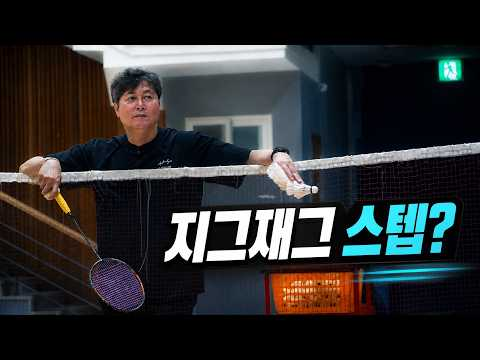](https://www.youtube.com/watch?v=rIuPBhoVbm4)

**[觀看原片](https://www.youtube.com/watch?v=rIuPBhoVbm4)｜full-swing｜2026-11-09｜11:27｜教學｜依據 B**

原題：Footwork Begins with the Right Decision

**強調技能：讀球距離與步數選擇**。標籤：步法、時機。

| 分析項目 | 內容 |
|---|---|
| 內容與技能 | 簡介聚焦腳步混亂及人球距離，提出先確認方向與距離，保持準備狀態，按情境選一步、兩步或三步。 |
| 分析／觀察重點 | 腳步快不等於到位快；觀察是否多走一步、過度衝近或來不及引拍。不要把所有來球硬套同一節奏。 |
| 建議練法（本報編製） | 由近、中、遠三個餵球距離開始，先固定再隨機；每球後說出自己用了幾步及距離是否合適。 |
| 檢查方法（本報編製） | 三種距離各 10 球，分別記錄多餘調整步及失衡次數。 |

**定位重點：** [1:55 步法](https://www.youtube.com/watch?v=rIuPBhoVbm4&t=115s)；[4:40 引拍](https://www.youtube.com/watch?v=rIuPBhoVbm4&t=280s)；[8:36 一、二、三步](https://www.youtube.com/watch?v=rIuPBhoVbm4&t=516s)。

來源：[full-swing 原影片頁面及其發布資料](https://www.youtube.com/watch?v=rIuPBhoVbm4)。本次保存的[來源資料](資料/rIuPBhoVbm4.page.json)。

### V14｜殺球步法與時機修正

[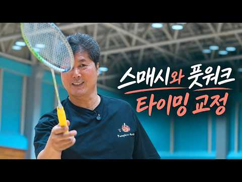](https://www.youtube.com/watch?v=1U4Wtnk4pT8)

**[觀看原片](https://www.youtube.com/watch?v=1U4Wtnk4pT8)｜full-swing｜2026-11-05｜12:49｜教學｜依據 B**

原題：🏸 Footwork and Timing Corrections to Transform Your Smash

**強調技能：後退平衡、步幅與轉身**。標籤：步法、時機、揮拍。

| 分析項目 | 內容 |
|---|---|
| 內容與技能 | 簡介包含先準備肩身、後移時保留重心、最後一步步幅及轉身，並依來球高度與速度選擇移動方式。 |
| 分析／觀察重點 | 留意最後一步如何把移動接到擊球，而非單獨模仿起跳。左右腳口令與示範者持拍側有關，左手者需鏡像理解。 |
| 建議練法（本報編製） | 先不用跳殺：中心出發接固定後場高球，中速擊球後回位；穩定後才加入不同深度。 |
| 檢查方法（本報編製） | 每 10 球記錄擊後可平衡回位、向後倒及最後多補一步的次數。 |

**定位重點：** [0:58 後移重心](https://www.youtube.com/watch?v=1U4Wtnk4pT8&t=58s)；[2:20 最後步幅](https://www.youtube.com/watch?v=1U4Wtnk4pT8&t=140s)；[6:46 看球移動](https://www.youtube.com/watch?v=1U4Wtnk4pT8&t=406s)；[10:42 重心轉移](https://www.youtube.com/watch?v=1U4Wtnk4pT8&t=642s)。

來源：[full-swing 原影片頁面及其發布資料](https://www.youtube.com/watch?v=1U4Wtnk4pT8)。本次保存的[來源資料](資料/1U4Wtnk4pT8.page.json)。

### V15｜殺球時機：從對方出球便開始觀察

**[觀看原片](https://www.youtube.com/watch?v=vOlRQx3qF5Q)｜full-swing｜2026-11-05｜16:38｜教學｜依據 B**

原題：Smash Timing Starts at the Shuttle’s Release

**強調技能：來球速度與引拍節奏**。標籤：時機、揮拍。

| 分析項目 | 內容 |
|---|---|
| 內容與技能 | 簡介把殺球出手拖延與拍身動作順序連結，強調從球的出發位置觀察速度，調整揮拍起始。 |
| 分析／觀察重點 | 先分清「準備太遲」和「準備很早但過早揮完」。兩者結果都可能打不好，修正方向卻不同。 |
| 建議練法（本報編製） | 相同落點交替較快與較慢餵球，維持同一目標區；比較引拍開始時間，而非只盯最後接觸一刻。 |
| 檢查方法（本報編製） | 每種速度 10 球，記錄過早、合適、過遲三類接觸。 |

**定位重點：** [0:00 延遲](https://www.youtube.com/watch?v=vOlRQx3qF5Q&t=0s)；[2:38 時機](https://www.youtube.com/watch?v=vOlRQx3qF5Q&t=158s)；[3:28 細節](https://www.youtube.com/watch?v=vOlRQx3qF5Q&t=208s)；[9:07 拍面方向](https://www.youtube.com/watch?v=vOlRQx3qF5Q&t=547s)。

來源：[full-swing 原影片頁面及其發布資料](https://www.youtube.com/watch?v=vOlRQx3qF5Q)。本次保存的[來源資料](資料/vOlRQx3qF5Q.page.json)。

### V16｜等待擊球點：同步揮拍與步法

[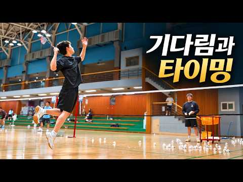](https://www.youtube.com/watch?v=EU7zW_yTElc)

**[觀看原片](https://www.youtube.com/watch?v=EU7zW_yTElc)｜full-swing｜2026-11-05｜12:28｜教學｜依據 B**

原題：🏸 Wait for the Shuttlecock to Create Precise Contact and Swing Timing

**強調技能：人球距離、身體與手臂順序**。標籤：時機、揮拍、步法。

| 分析項目 | 內容 |
|---|---|
| 內容與技能 | 簡介說明過早抬肘或出手會令擊球點偏離身體，主張按軌跡與速度等到合適範圍，再連接轉身與手臂動作。 |
| 分析／觀察重點 | 優先找可控制的接觸區域，不要只模仿「等久一點」。本片與等待主題重疊，可作對照修正而非全部連續看。 |
| 建議練法（本報編製） | 固定短距離輕餵，先讓腳步到位再做連貫揮拍；由側面看有沒有伸手追球及身體失衡。 |
| 檢查方法（本報編製） | 20 球中過度伸手、腳步未穩及目標區命中各幾次。 |

**定位重點：** [2:27 等擊球點](https://www.youtube.com/watch?v=EU7zW_yTElc&t=147s)；[6:15 看球踩步](https://www.youtube.com/watch?v=EU7zW_yTElc&t=375s)；[9:04 確定擊球點](https://www.youtube.com/watch?v=EU7zW_yTElc&t=544s)；[10:38 身體轉動](https://www.youtube.com/watch?v=EU7zW_yTElc&t=638s)。

來源：[full-swing 原影片頁面及其發布資料](https://www.youtube.com/watch?v=EU7zW_yTElc)。本次保存的[來源資料](資料/EU7zW_yTElc.page.json)。

### V17｜等待、引拍與步法綜合修正

[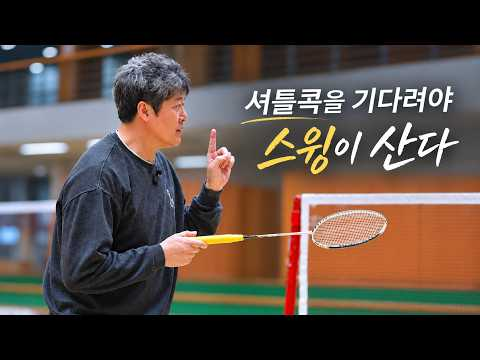](https://www.youtube.com/watch?v=Rh0hy-ToyeU)

**[觀看原片](https://www.youtube.com/watch?v=Rh0hy-ToyeU)｜full-swing｜2026-11-03｜39:42｜教學｜依據 B**

原題：🏸 Wait for the Shuttle: Fixing Timing, Backswing, and Footwork

**強調技能：依來球調整整體節奏**。標籤：時機、步法、揮拍。

| 分析項目 | 內容 |
|---|---|
| 內容與技能 | 長篇簡介與章節整合來球速度、引拍、身體轉動、擊球距離及不同步數；主題是修正過早搶動和僵硬固定步法。 |
| 分析／觀察重點 | 39 分鐘內容宜按問題選段。先用短片建立一項修正，再用本片核對其在不同來球下是否仍成立。 |
| 建議練法（本報編製） | 只選「引拍時機」一題，固定餵球做 10 球、變速餵球做 10 球；下次再處理步數，避免同時改所有動作。 |
| 檢查方法（本報編製） | 固定和變速條件分開記成功數，檢查技術能否轉移。 |

**定位重點：** [2:27 引拍時機](https://www.youtube.com/watch?v=Rh0hy-ToyeU&t=147s)；[13:59 擊球加速](https://www.youtube.com/watch?v=Rh0hy-ToyeU&t=839s)；[23:35 調整引拍](https://www.youtube.com/watch?v=Rh0hy-ToyeU&t=1415s)；[30:04 非固定兩步](https://www.youtube.com/watch?v=Rh0hy-ToyeU&t=1804s)；[31:20 步數選擇](https://www.youtube.com/watch?v=Rh0hy-ToyeU&t=1880s)。

來源：[full-swing 原影片頁面及其發布資料](https://www.youtube.com/watch?v=Rh0hy-ToyeU)。本次保存的[來源資料](資料/Rh0hy-ToyeU.page.json)。

### V18｜揮拍與步法：讀取並建立擊球時機

[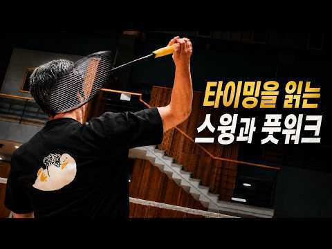](https://www.youtube.com/watch?v=bQ6ns6Ychoo)

**[觀看原片](https://www.youtube.com/watch?v=bQ6ns6Ychoo)｜full-swing｜2026-11-01｜37:51｜教學｜依據 B**

原題：🏸 Badminton Swings and Footwork: Reading and Creating Shuttle Timing

**強調技能：讀球、準備與連續回位**。標籤：時機、步法、揮拍。

| 分析項目 | 內容 |
|---|---|
| 內容與技能 | 簡介把對手揮拍、來球高低快慢與自己的引拍、步法及回位連接，亦列出防守、跳躍時機與減少多餘動作。 |
| 分析／觀察重點 | 這是跨主題長片，適合先有明確問題再找章節。章節存在不等於每種球路的完整技術已由本報核實。 |
| 建議練法（本報編製） | 一人餵、一人練、一人觀察；每輪只看準備是否跟來球同步，以及擊後是否立即建立下一拍準備。 |
| 檢查方法（本報編製） | 每 20 球記「擊球成功但未回位」與「已回位但讀錯方向」兩類。 |

**定位重點：** [7:53 回位節奏](https://www.youtube.com/watch?v=bQ6ns6Ychoo&t=473s)；[11:10 對方揮拍與引拍](https://www.youtube.com/watch?v=bQ6ns6Ychoo&t=670s)；[20:29 接殺準備](https://www.youtube.com/watch?v=bQ6ns6Ychoo&t=1229s)；[35:04 情境步法](https://www.youtube.com/watch?v=bQ6ns6Ychoo&t=2104s)。

來源：[full-swing 原影片頁面及其發布資料](https://www.youtube.com/watch?v=bQ6ns6Ychoo)。本次保存的[來源資料](資料/bQ6ns6Ychoo.page.json)。

### V19｜網前控制、殺球變化與進攻輪轉

[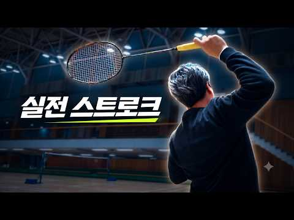](https://www.youtube.com/watch?v=lA6RTlaN5Os)

**[觀看原片](https://www.youtube.com/watch?v=lA6RTlaN5Os)｜full-swing｜2026-11-05｜12:53｜教學｜依據 B**

原題：🏸 Badminton Lesson: From Net Control to Smashes and Attacking Rotation

**強調技能：前後場銜接與變速**。標籤：網前、戰術、輪轉、揮拍。

| 分析項目 | 內容 |
|---|---|
| 內容與技能 | 簡介與章節由網前拍頭和揮速調整，延伸至平抽、防守拍位、殺球強弱及擊後進攻輪轉。 |
| 分析／觀察重點 | 把技術放回下一拍：網前處理是否迫使對手挑球，殺球後誰補網？同準備動作下的吊殺變化，比單純求大力更值得比較。 |
| 建議練法（本報編製） | 先做網前控制到對方挑球，再由後場進攻，前場搭檔按回球補位；固定球路熟悉後才加入自由防守。 |
| 檢查方法（本報編製） | 10 輪記成功形成後場進攻次數，以及進攻後失去前場覆蓋次數。 |

**定位重點：** [2:24 網前引出挑球](https://www.youtube.com/watch?v=lA6RTlaN5Os&t=144s)；[5:18 殺球強弱](https://www.youtube.com/watch?v=lA6RTlaN5Os&t=318s)；[8:48 進攻輪轉](https://www.youtube.com/watch?v=lA6RTlaN5Os&t=528s)；[9:56 同動作吊殺](https://www.youtube.com/watch?v=lA6RTlaN5Os&t=596s)。

來源：[full-swing 原影片頁面及其發布資料](https://www.youtube.com/watch?v=lA6RTlaN5Os)。本次保存的[來源資料](資料/lA6RTlaN5Os.page.json)。

### V20｜關鍵分如何控制失誤（待補內容）

**[觀看原片](https://www.youtube.com/watch?v=tEfgBcpmznA)｜大G羽毛球｜2026-11-15｜3:30｜待補分析｜依據 C**

原題：比赛关键分如何控制失误？刘辉教练教你羽毛球单打比赛失误率最低的打法#羽毛球教学

**強調技能：單打風險選擇（僅標題確認）**。標籤：戰術。

| 分析項目 | 內容 |
|---|---|
| 內容與技能 | 已核實標題、發布日期、頻道及時長。簡介只是重複標題，未取得可用字幕或完整影片內容，不能確認教練實際提出的低失誤打法。 |
| 分析／觀察重點 | 待看時請記錄：所指失誤是選球還是執行？有哪些前提？有沒有示範落點與回位？暫不轉述具體口令。 |
| 建議練法（本報編製） | 可先建立自己的關鍵分紀錄：分開標記出界、下網、選球後失位；此為本報獨立建議，並非影片摘要。 |
| 檢查方法（本報編製） | 先收集自己的 20 個回合，再計算各類失誤次數；不假定任何打法能保證失誤最低。 |

來源：[大G羽毛球 原影片頁面及其發布資料](https://www.youtube.com/watch?v=tEfgBcpmznA)。本次保存的[來源資料](資料/tEfgBcpmznA.page.json)。

### V21｜與鄭思維的訓練營紀錄

**[觀看原片](https://www.youtube.com/watch?v=37zufC7qBQs)｜Badminton Insight｜2026-11-01｜10:49｜觀摩｜依據 C**

原題：We Ran A Training Camp With Olympic Champion, Zheng Siwei!

**強調技能：訓練觀摩**。標籤：觀摩。

| 分析項目 | 內容 |
|---|---|
| 內容與技能 | 標題確認與鄭思維相關的訓練營紀錄；簡介主要是課程連結。缺少可核對內容，不能把片中訓練方法、負荷或口令當作已分析。 |
| 分析／觀察重點 | 觀察時可暫停記錄：擊球者位置、搭檔位置、來球及下一拍；先完成樣本才歸納。 |
| 建議練法（本報編製） | 自行挑 10 個完整回合，畫出擊球前後站位，與雙打輪轉教學對照。這是觀摩任務，不是已完成的比賽結果。 |
| 檢查方法（本報編製） | 記錄樣本回合及時間碼，避免只以精彩球代表全場。 |

來源：[Badminton Insight 原影片頁面及其發布資料](https://www.youtube.com/watch?v=37zufC7qBQs)。本次保存的[來源資料](資料/37zufC7qBQs.page.json)。

### V22｜挑戰中國兩位教練

**[觀看原片](https://www.youtube.com/watch?v=6_8Widm99cE)｜Badminton Insight｜2026-11-08｜10:14｜觀摩｜依據 C**

原題：Can We Beat 2 Coaches In China?

**強調技能：對戰觀摩**。標籤：觀摩。

| 分析項目 | 內容 |
|---|---|
| 內容與技能 | 標題確認是對戰挑戰；不應因簡介有教學課程廣告就歸為正式教學。未做逐球影像分析。 |
| 分析／觀察重點 | 觀察時可暫停記錄：擊球者位置、搭檔位置、來球及下一拍；先完成樣本才歸納。 |
| 建議練法（本報編製） | 自行挑 10 個完整回合，畫出擊球前後站位，與雙打輪轉教學對照。這是觀摩任務，不是已完成的比賽結果。 |
| 檢查方法（本報編製） | 記錄樣本回合及時間碼，避免只以精彩球代表全場。 |

來源：[Badminton Insight 原影片頁面及其發布資料](https://www.youtube.com/watch?v=6_8Widm99cE)。本次保存的[來源資料](資料/6_8Widm99cE.page.json)。

### V23｜殺球對決：高陽市廳對 Yonex

**[觀看原片](https://www.youtube.com/watch?v=OusC2RPJDQE)｜full-swing｜2026-11-04｜12:30｜觀摩｜依據 C**

原題：Final Showdown: The War of the Smash (feat. Lee Yong-Dae)

**強調技能：比賽觀摩**。標籤：觀摩。

| 分析項目 | 內容 |
|---|---|
| 內容與技能 | 簡介列出兩隊及三段比賽，屬對局觀摩。未取得逐球資料，不能斷定球員使用某模式的頻率或成效。 |
| 分析／觀察重點 | 觀察時可暫停記錄：擊球者位置、搭檔位置、來球及下一拍；先完成樣本才歸納。 |
| 建議練法（本報編製） | 自行挑 10 個完整回合，畫出擊球前後站位，與雙打輪轉教學對照。這是觀摩任務，不是已完成的比賽結果。 |
| 檢查方法（本報編製） | 記錄樣本回合及時間碼，避免只以精彩球代表全場。 |

來源：[full-swing 原影片頁面及其發布資料](https://www.youtube.com/watch?v=OusC2RPJDQE)。本次保存的[來源資料](資料/OusC2RPJDQE.page.json)。

### V24｜四支進攻拍力量比較

**[觀看原片](https://www.youtube.com/watch?v=xj1kb8F33Rg)｜Badminton Famly｜2026-11-13｜10:45｜器材｜依據 B**

原題：Which Badminton Racket Is BEST for Power? 4 Rackets Tested!

**強調技能：器材／訓練工具**。標籤：器材。

| 分析項目 | 內容 |
|---|---|
| 內容與技能 | 簡介列出 Victor Thruster Ryuga 3、Li-Ning Axforce 90、Hundred Nitrix 80 Bullet、Yonex Astrox 77 PRO，比較力量、速度與控制。未核實測試結果，不列勝負或購買建議。 |
| 分析／觀察重點 | 把設備與技能分開：比較前先問來球是否可重複、條件是否一致；本報不把器材測試當作技術提升證據。 |
| 建議練法（本報編製） | 球拍比較可固定球、線、場地與目標；發球機可記錄設定與實際落點。這些是本報建議的比較條件。 |
| 檢查方法（本報編製） | 記錄相同條件下的命中與偏差；本片無已核實的客觀結果可轉錄。 |

來源：[Badminton Famly 原影片頁面及其發布資料](https://www.youtube.com/watch?v=xj1kb8F33Rg)。本次保存的[來源資料](資料/xj1kb8F33Rg.page.json)。

### V25｜與丹麥選手測試 Thruster Ryuga 3

**[觀看原片](https://www.youtube.com/watch?v=Cavxva8xHEQ)｜Badminton Famly｜2026-10-23｜10:03｜器材｜依據 B**

原題：We Tested the NEW Victor Thruster Ryuga 3 With World-Class Players!

**強調技能：器材／訓練工具**。標籤：器材。

| 分析項目 | 內容 |
|---|---|
| 內容與技能 | 簡介提及與 Mads Vestergaard、Daniel Lundgaard 討論器材選擇並測試球拍；屬器材內容。個別選手偏好不能直接代表你的適用性。 |
| 分析／觀察重點 | 把設備與技能分開：比較前先問來球是否可重複、條件是否一致；本報不把器材測試當作技術提升證據。 |
| 建議練法（本報編製） | 球拍比較可固定球、線、場地與目標；發球機可記錄設定與實際落點。這些是本報建議的比較條件。 |
| 檢查方法（本報編製） | 記錄相同條件下的命中與偏差；本片無已核實的客觀結果可轉錄。 |

來源：[Badminton Famly 原影片頁面及其發布資料](https://www.youtube.com/watch?v=Cavxva8xHEQ)。本次保存的[來源資料](資料/Cavxva8xHEQ.page.json)。

### V26｜TrainBot 發球機測試

**[觀看原片](https://www.youtube.com/watch?v=cx_L7zdAeAE)｜Badminton Famly｜2026-10-31｜6:46｜器材｜依據 B**

原題：We Tested the Future of Badminton Training! 🤖 | TrainBot

**強調技能：器材／訓練工具**。標籤：器材。

| 分析項目 | 內容 |
|---|---|
| 內容與技能 | 簡介說明於丹麥公開賽期間測試發球機，以三種練習挑戰準確性等表現；沒有足夠內容核實各項實際成績。 |
| 分析／觀察重點 | 把設備與技能分開：比較前先問來球是否可重複、條件是否一致；本報不把器材測試當作技術提升證據。 |
| 建議練法（本報編製） | 球拍比較可固定球、線、場地與目標；發球機可記錄設定與實際落點。這些是本報建議的比較條件。 |
| 檢查方法（本報編製） | 記錄相同條件下的命中與偏差；本片無已核實的客觀結果可轉錄。 |

來源：[Badminton Famly 原影片頁面及其發布資料](https://www.youtube.com/watch?v=cx_L7zdAeAE)。本次保存的[來源資料](資料/cx_L7zdAeAE.page.json)。

## 5. 技能對照與容易混淆的提示

| 主題 | 影片間的關聯 | 使用時的判斷 |
|---|---|---|
| 放鬆握拍 | V05、V06 處理手指；V08、V10 接到揮拍 | 放鬆指準備階段可調整；不等於擊球時完全沒有握拍控制 |
| 等待來球 | V11、V12、V15、V16、V17 | 分清讀球、移動、引拍、最後加速四個時機；避免把等待變成停止準備 |
| 高／低擊球點 | V09、V11、V16 的修正情境不同 | 要先看是網前、平抽、後場或受迫球；不能概括成一律越高或越低越好 |
| 固定步法與情境步法 | V03 重節奏；V13、V14 重選步與平衡 | 固定練習建立動作，變化來球檢查選擇；兩種資料分開記錄 |
| 雙打輪轉 | V01 給原則，V02 分情境，V19 串連球路 | 依回球品質及搭檔位置調整；不是每一拍都照預定方向換位 |
| 用核心／不用肩腕 | V06、V07、V08、V10 | 這些是減少多餘緊張的教學提示；本報沒有關節動力學量測可判定發力比例 |

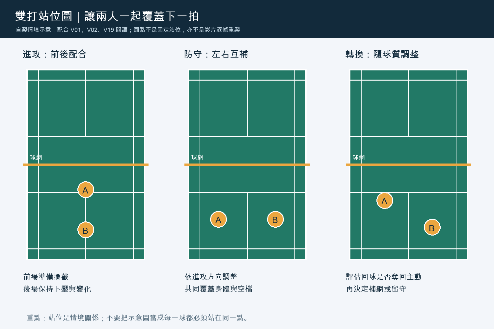

## 6. 四週學習及回看計畫

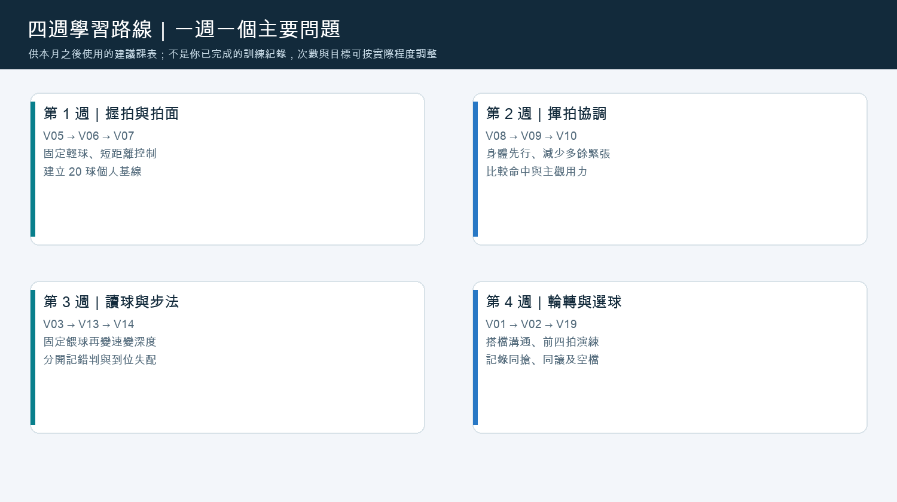

建議每週兩次、每次約 40–50 分鐘作為起點，按你既有訓練與程度調整。每次先完成平常熱身，再安排看一小段影片、固定練習、變化來球、回看錄影。當天只帶一個主要修正提示進場。以下是學習規劃，不是對你目前技術的診斷。

| 週次 | 影片與主題 | 第一次：建立動作 | 第二次：檢查能否運用 | 留下的證據 |
|---|---|---|---|---|
| 1 | V05、V06、V07；握拍與拍面 | 固定輕球，短距離控制 | 正反手切換及兩種落點 | 20 球命中數、方向失控數、側面短片 |
| 2 | V08、V09、V10；揮拍協調 | 固定餵球，處理一個多餘動作 | 同目標下改變速度與力度 | 命中、下網、主觀用力及重複引拍次數 |
| 3 | V03、V13、V14；讀球步法 | 固定步法和節奏 | 近中遠或快慢隨機來球 | 錯判方向、到位失配及失衡分開記 |
| 4 | V01、V02、V19；輪轉與選球 | 兩人半速配合與前四拍 | 同條件下開放回球選擇 | 同搶、同讓、空檔與成功轉換次數 |

### 練習紀錄模板

| 日期／影片 | 條件（球路、落點、速度） | 嘗試數 | 命中數 | 錯判方向 | 到位失配 | 多餘步／引拍 | 主觀用力 1–10 | 下次只改一項 |
|---|---|---:|---:|---:|---:|---:|---:|---|
| 待填 | 固定或隨機須註明 | 20 |  |  |  |  |  |  |

命中率＝命中數 ÷ 嘗試數；同一人、同條件前後比較才較有意義。20 球是方便記錄的建議單位，不是驗證技能已掌握的標準。這些欄位衡量不同問題，請勿把它們直接加總成能力分數。

## 7. 檢索範圍、缺口與來源紀錄

本次以「badminton tutorial」「羽球 教學」「羽毛球 教学」搜尋，並檢查 Badminton Insight、Badminton Famly、Tobias Wadenka、full-swing，以及瓜仔、安東、KT、Bonny、大G、Jeff's、小羊等候選頻道。去重後共有 **270 個候選項目**：**139 支影片核實到發布日期、117 支影片未能核實日期、14 個頻道或播放清單項目**。已核實日期的影片中，26 支符合本期。頻道頁各取有限數量的近期影片，搜尋亦為有限結果，不代表全站或所有頻道已找齊。

後續讀取遇到 YouTube 登入／流量限制；未核實日期的項目沒有混入月份統計。期間內僅 V01 成功取得可讀英文字幕；其餘按發布者簡介／章節分析，V20 只確認主題，V21–V23 只提供觀摩任務。中文內容的本期覆蓋不足，不能把它解讀成期間內只有一支中文教學。沒有確認下來的影片，亦不等同不符合日期。

**Jev 使用紀錄：** 僅向 Jev 提交公開影片標題與簡介，協助「教學／觀摩／器材」分類，沒有提交本地個人訓練筆記。先試跑 5 筆；其中訓練營紀錄的信心為 0.44，已人工複核。試跑亦發現對戰片被課程廣告干擾而誤分，已調整分類提示再跑全批。正式批次 26 筆均不低於 0.6，仍逐筆人工複核；Jev 判為教學的 20 支中，V20 因內容不足改列「待補分析」。技能文字、圖表與課表由本報編製，並非 Jev 產生。

| 本地檔案 | 用途 |
|---|---|
| [檢索稽核.json](資料/檢索稽核.json) | 全部候選、核實狀態、原始連結與範圍 |
| [待核實日期.json](資料/待核實日期.json) | 本期未能完成日期核實的候選 |
| [period_verified.json](資料/period_verified.json) | 本期 26 支已核實日期的影片資料 |
| [analysis.json](資料/analysis.json) | 每支影片的技能分析與學習欄位 |
| [Jev 試跑結果](資料/jev_sample_results.jsonl)／[正式結果](資料/jev_results.jsonl) | 分類過程與信心 |
| [V01 字幕核對筆記](資料/V01_字幕核對筆記.txt) | 自撰時間索引，供返回原影片回查；不附完整字幕 |

縮圖來自各影片的 YouTube 縮圖端點（`i.ytimg.com/vi/影片ID/hqdefault.jpg`），權利屬原創作者；原影片連結保留於每張圖與每支分析。技能關聯、站位與四週路線三圖為本報自製示意，沒有假裝成影片截圖或真實動作量測。

下期應優先補核中文頻道日期及 V20 全片內容；本次為一次月報，尚未建立每月自動更新。
