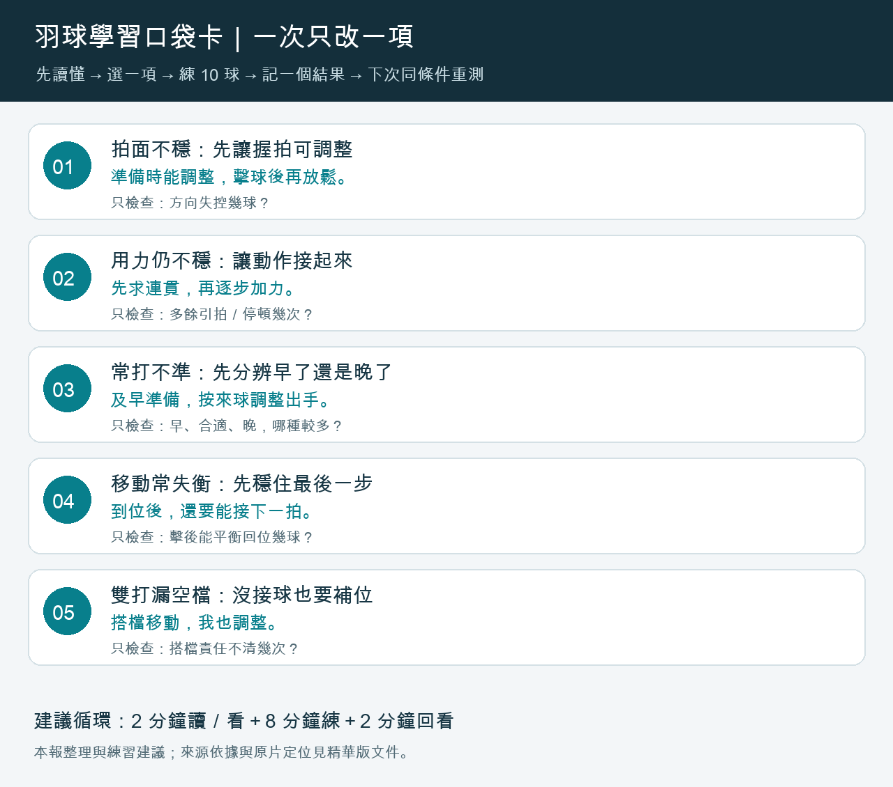

# 羽球教學精華版｜少看影片，每次練好一件事

**整理自 2026/10/16–11/15 月報｜2026/11/15 編製｜約 1 分鐘先讀速讀表**

先讀下面五句，再選一項最像你的問題。每次練球只用一個提示、記一個結果；需要看動作時，才打開對應短片段。

## 1. 先記住這五句

| 常見問題 | 今天只帶這句上場 | 只檢查一件事 |
|---|---|---|
| 拍面不穩 | **準備時能調整，擊球後再放鬆。** | 只記「方向失控幾球」 |
| 用力仍不穩 | **先求連貫，再逐步加力。** | 只記「多餘引拍／停頓幾次」，先不追球速。 |
| 常打不準 | **及早準備，按來球調整出手。** | 每球只分「早／合適／晚」 |
| 移動常失衡 | **到位後，還要能接下一拍。** | 只記「擊球後能平衡回位幾球」 |
| 雙打漏空檔 | **搭檔移動，我也調整。** | 只記「責任不清的次數」 |

## 2. 今天要選哪一項

用最近一次練球或比賽的情況選題，這是排查入口，不是技術診斷。

| 最近最明顯的問題 | 本次選題 |
|---|---|
| 握得很緊、換正反手不順 | 01 握拍與拍面 |
| 揮拍中斷、一直用手推 | 02 動作連貫 |
| 常過早揮完或伸手追球 | 03 擊球時機 |
| 勉強打到，卻失衡或回不來 | 04 最後一步與回位 |
| 雙打同搶、同讓、沒接球就停住 | 05 無球補位 |

如果還不知道問題在哪裡，先錄一小段自己的擊球，從上述現象挑一項；不必把五項同時練。單打者可先略過第 05 項。

## 3. 五張重點練習卡

### 01｜拍面不穩：先讓握拍可調整

**一句提示：準備時能調整，擊球後再放鬆。**

保留手指調整握柄和拍面的空間；避免從準備到擊球後都一直用力握緊。影片的手指分工是教學提示，會隨球路改變。

| 項目 | 今天怎樣做 |
|---|---|
| 需要看動作才打開 | [V06 · 1:33–3:08｜拇指、食指與握拍控制](https://www.youtube.com/watch?v=jwKZsDfNR6E&t=93s)，約 95 秒；到結尾時間即可停 |
| 只看甚麼 | 只看握柄如何被手指控制，先不模仿大幅揮拍。 |
| 練習（本報建議） | 短距離輕餵 10 球，固定同一目標。每球後讓握拍恢復可調整的狀態；重做一組。 |
| 自我檢查 | 只記「方向失控幾球」；兩組用相同目標和餵球條件。 |
| 下一步 | 固定球較穩後，再交替正反手，檢查換握是否仍順。 |
| 沒有搭檔時 | 無球慢速換正反手拍面 10 次；只能檢查換握，不能代替有球控制。 |

**避免誤解：** 放鬆不等於握不住，也不等於每根手指永遠固定出力。

### 02｜用力仍不穩：讓動作接起來

**一句提示：先求連貫，再逐步加力。**

把身體轉動、手臂和拍頭連成一個動作。先檢查是否有多餘推拍或重複引拍，再談加大力量；不是把手臂鎖住。

| 項目 | 今天怎樣做 |
|---|---|
| 需要看動作才打開 | [V08 · 6:29–7:54｜身體轉動帶動球拍](https://www.youtube.com/watch?v=pzpyti1sS-I&t=389s)，約 85 秒；到結尾時間即可停 |
| 只看甚麼 | 注意轉身如何連到球拍，而非只看最後打出去那一刻。 |
| 練習（本報建議） | 慢揮 5 次，再接固定輕餵 5 球。側面錄影，只檢查有沒有「引拍完又再引一次」的停頓。 |
| 自我檢查 | 只記「多餘引拍／停頓幾次」，先不追球速。 |
| 下一步 | 固定輕球後，稍微改變餵球速度，看動作是否又變得僵硬。 |
| 沒有搭檔時 | 側面錄影慢揮 5 次，只找中斷；沒有球時看不出實際擊球時機。 |

**避免誤解：** 「身體帶動」不等於只轉腰；「別用肩腕硬推」也不等於肩腕完全不參與。

### 03｜常打不準：先分辨早了還是晚了

**一句提示：及早準備，按來球調整出手。**

準備、移動與最後加速是不同的時機。從對方出球便觀察速度和軌跡，再調整揮拍起始；不能把「等球」理解為站著不準備。

| 項目 | 今天怎樣做 |
|---|---|
| 需要看動作才打開 | [V15 · 2:38–3:28｜揮拍時機](https://www.youtube.com/watch?v=vOlRQx3qF5Q&t=158s)，約 50 秒；到結尾時間即可停 |
| 只看甚麼 | 只帶一個問題看：是準備太遲，還是準備早但過早揮完？ |
| 練習（本報建議） | 請搭檔交替慢、稍快的球，落點盡量相同，各 10 球；維持同一目標，觀察自己是否跟得上節奏。 |
| 自我檢查 | 每球只分「早／合適／晚」；不確定就記「？」並回看錄影。 |
| 下一步 | 速度變化能處理後，再改深度；一次只改一個餵球條件。 |
| 沒有搭檔時 | 可回看自己以往的擊球錄影；純無球揮拍無法驗證讀球與擊球同步。 |

**避免誤解：** 不是所有球都該等低、搶高或晚出手；球路與擊球情境不同。

### 04｜移動常失衡：先穩住最後一步

**一句提示：到位後，還要能接下一拍。**

把後退、最後一步與擊球連起來，先維持平衡再加速。步數和步幅要配合來球距離，不用每一球都套相同節奏。

| 項目 | 今天怎樣做 |
|---|---|
| 需要看動作才打開 | [V14 · 0:58–2:20｜後退時保持重心](https://www.youtube.com/watch?v=1U4Wtnk4pT8&t=58s)，約 82 秒；到結尾時間即可停 |
| 只看甚麼 | 看擊球前後能否保持平衡，不先學跳殺。 |
| 練習（本報建議） | 從中心出發接固定後場高球，中等力度擊球後回位，做 10 球。第一組先不用跳。 |
| 自我檢查 | 只記「擊球後能平衡回位幾球」；不要同時追移動速度。 |
| 下一步 | 固定落點可控制後，再加入較近或較遠的來球。 |
| 沒有搭檔時 | 半速做後退、模擬擊球、回位，錄影看是否向後倒；仍需有球驗證距離。 |

**避免誤解：** 左右腳口令要配合持拍側；不要把示範者某次步法當作所有來球的標準。

### 05｜雙打漏空檔：沒接球也要補位

**一句提示：搭檔移動，我也調整。**

單打多半向情境基地回復；雙打則跟搭檔及回球品質調整。進攻常以前後配合，防守常以左右互補，但站位不是固定點。

| 項目 | 今天怎樣做 |
|---|---|
| 需要看動作才打開 | [V01 · 4:18–5:21｜單雙打站位差異](https://www.youtube.com/watch?v=8GAmxmLXc70&t=258s)，約 63 秒；到結尾時間即可停 |
| 只看甚麼 | 只追蹤沒有擊球的那位搭檔，看他在填補哪個空間。 |
| 練習（本報建議） | 和搭檔半速做 10 次攻守轉換；每次停下來指出各自負責的區域，再加入慢速來球。 |
| 自我檢查 | 只記「責任不清的次數」；同搶或同讓都算，先不追比分。 |
| 下一步 | 先約定前四拍責任，再打 10 輪短回合，確認實際來球下仍能補位。 |
| 沒有搭檔時 | 回看雙打錄影，只追蹤無球者的位置；實際配合仍需要搭檔。 |

**避免誤解：** 不是每打一拍都要換位；要根據回球品質及搭檔位置決定。

## 4. 只想看片段：五段合共 6 分 15 秒

不用一次全看，依今天弱項選一段即可。以下是依既有字幕／章節選定的閱讀範圍；連結跳到開始處，**不會自動停止**。結束時間是閱讀停點，並非聲稱這段已涵蓋整套技術。

| 題目 | 定位 | 長度 | 依據 |
|---|---|---:|---|
| 拍面不穩：先讓握拍可調整 | [1:33–3:08｜拇指、食指與握拍控制](https://www.youtube.com/watch?v=jwKZsDfNR6E&t=93s) | 95 秒 | 發布者章節／簡介 |
| 用力仍不穩：讓動作接起來 | [6:29–7:54｜身體轉動帶動球拍](https://www.youtube.com/watch?v=pzpyti1sS-I&t=389s) | 85 秒 | 發布者章節／簡介 |
| 常打不準：先分辨早了還是晚了 | [2:38–3:28｜揮拍時機](https://www.youtube.com/watch?v=vOlRQx3qF5Q&t=158s) | 50 秒 | 發布者章節／簡介 |
| 移動常失衡：先穩住最後一步 | [0:58–2:20｜後退時保持重心](https://www.youtube.com/watch?v=1U4Wtnk4pT8&t=58s) | 82 秒 | 發布者章節／簡介 |
| 雙打漏空檔：沒接球也要補位 | [4:18–5:21｜單雙打站位差異](https://www.youtube.com/watch?v=8GAmxmLXc70&t=258s) | 63 秒 | 已讀字幕 |

## 5. 每次加一個 12 分鐘小循環

先完成平常熱身，再把下面流程加進原本的練球。時間與球數是方便執行的建議，不是能力達標標準。

1. **2 分鐘：讀／看。** 選一張卡，讀一句提示；仍不懂動作才看片段。
2. **8 分鐘：練。** 相同條件先做 10 球，記結果，再做一組；若是無球或兩人站位練習，以 10 次記。
3. **2 分鐘：回看。** 只核對這次選的問題，寫一句下次要繼續做的事。

| 日期／題目 | 固定條件 | 第一組結果 | 第二組結果 | 下次只做一件事 |
|---|---|---|---|---|
| 例：01 拍面控制 | 同落點、同目標，各 10 球 | 方向失控 __ 球 | 方向失控 __ 球 | 擊球後恢復可調整握拍 |

第二組變好只是當次線索。下次先用相同條件重測；能穩定重現後，再改速度、落點或加入實際回合。固定餵球進步，也要檢查變化來球能不能用。

## 6. 暫時不用排進你的短看單

花式球、器材評測、整場對戰及重複主題的長片可留待需要時查閱。這份精華版先聚焦五個可練、可記錄的問題；不是要在一次練球內學完。

**資料範圍：** 本版重新編排既有月報，沒有新增全片觀看。V01 已讀可用字幕，其餘指定片段依發布者章節與簡介選定；不能視作已逐幀驗證。練習、指標、12 分鐘流程與口袋卡由本報編製，未證實適合你的個別動作。未取得內容的 V20 不納入精華。

[回到完整月報](羽球YouTube教學月報_20261016-20261115.md)｜[開啟精華圖文版](學習精華_瀏覽版.html)
