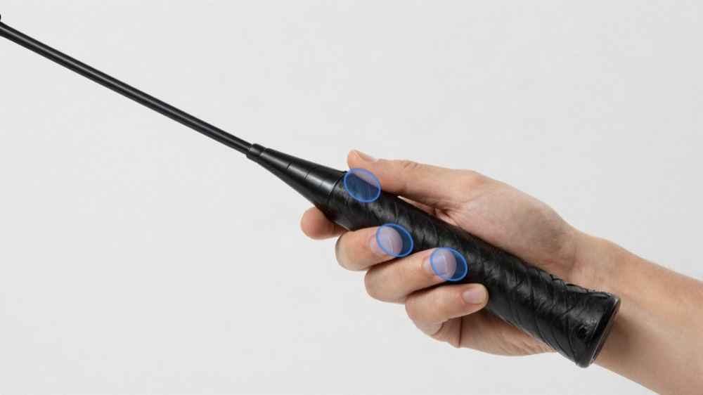
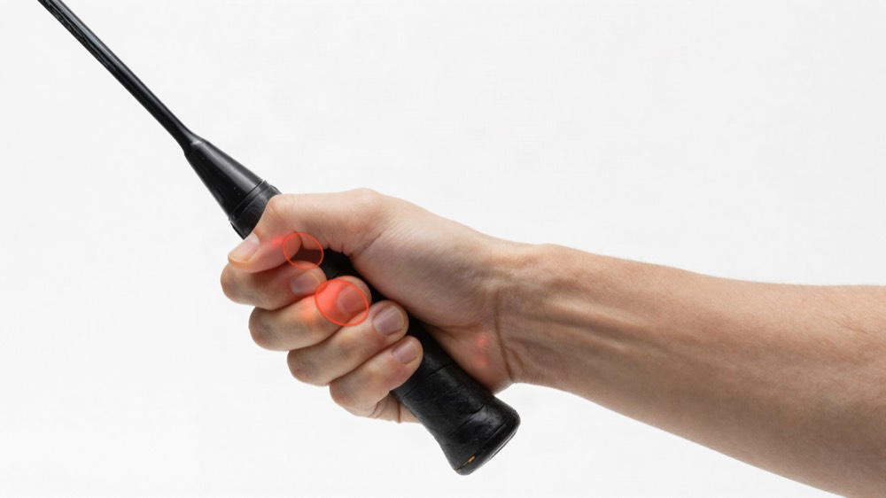
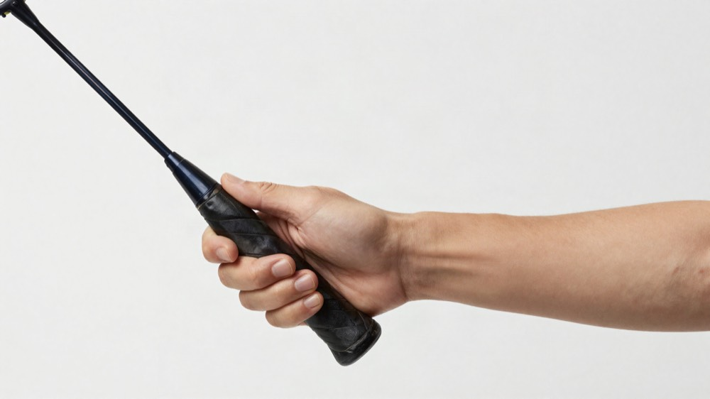
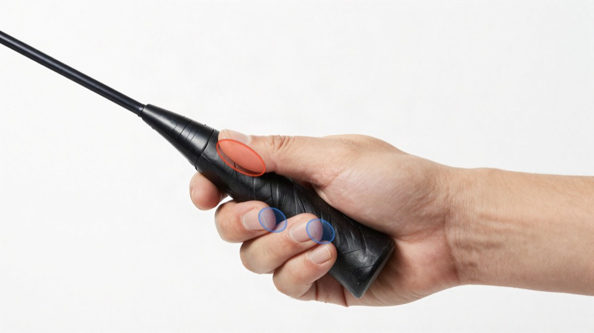
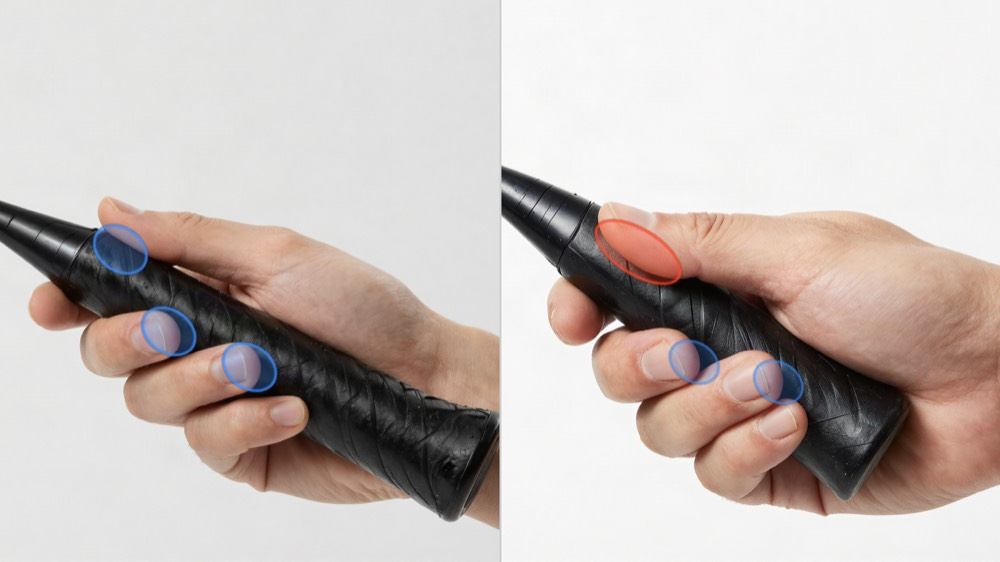
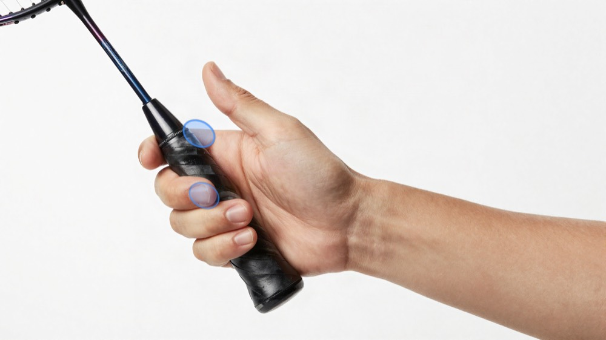
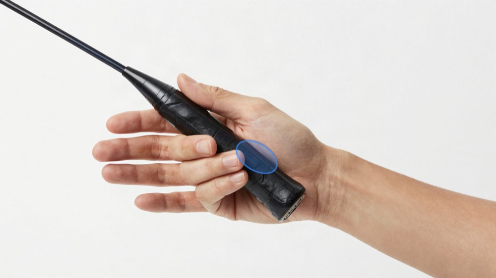
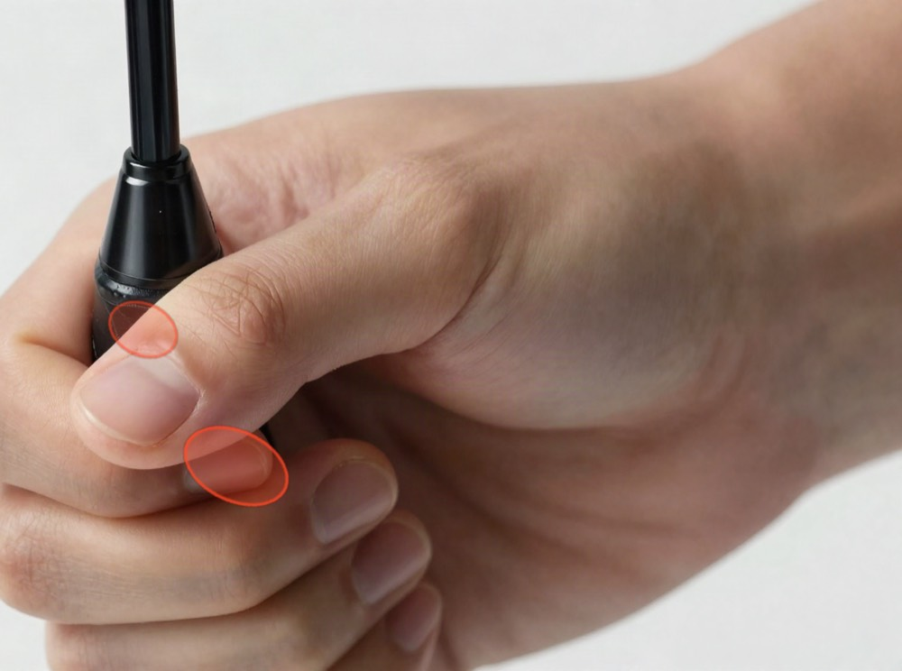

# 手指發力：先放鬆，觸球前才握緊

整理日期：2026-11-23（澳門時間）｜對象：國一至國三

網頁版：https://winglao.github.io/badminton/learn/badminton-2026-11-23/

**5** 個細節，一次只練一個

**4** 個練習階段，從無球到對打

**0.41 秒** 選手殺球時握緊的時間（初學者約 1.25 秒）

## 一分鐘重點

1.  手指發力就是：平時輕輕握，觸球前一瞬間才握緊，打完馬上放鬆。
2.  它是全身用力的**最後一環**：腳 → 身體 → 肩 → 手肘 → 前臂 → 手腕 → 手指。手指不是主力，是最後加速。
3.  正手多用食指往前頂，反手多用大拇指往前推。
4.  高手和初學者最大的分別**不是握得多大力**，而是握緊的時間短。
5.  先練無球換握，再練顆球、多球，最後才放進對打。

**看圖小提示**：圖中的 **藍圈** 是「輕輕貼住」的位置，**紅圈** 是「這一刻用力」的位置。

## 五個細節（一次練一個）

每個細節都有：一句提示 → 看甚麼 → 怎樣練 → 只記一項結果。

### 細節 1｜放鬆握拍

💡 一句提示：手掌和拍柄之間，留一點空隙。

**看甚麼**

- **準備時**：主要靠大拇指、食指、中指控制球拍，其他手指輕輕扶住。
- **擊球時**：觸球前才收緊，不是一直用力。
- **下一拍**：打完馬上回到放鬆，才來得及準備下一球。

**怎樣練**

1.  正手握好球拍，把拍頭指向前方。
2.  用 1 到 10 分給自己的握力打分：1 是快掉下來，10 是用盡全力。
3.  把握力調到 **3 分或以下**，保持 10 秒。
4.  低頭看手掌心：手掌和拍柄之間還有一點空隙（大約放得進一根手指），球拍又不會掉，就做對了。

✅ 只記一項：準備時握力是幾分？（目標 3 分或以下）

### 細節 2｜正手：食指頂、四指收緊

💡 一句提示：觸球前一瞬間，四隻手指一起收緊。

 

**看甚麼**

- **準備時**：仍然是細節 1 的放鬆握拍。
- **擊球時**：中指、無名指、小指收緊，食指往前頂；前臂同時向內轉，這個動作叫**旋前**（前臂向內轉，像轉開門把）。
- **下一拍**：拍頭保持在身體前面，打完馬上放鬆。

**怎樣練**

1.  站在網前，隊友在對面用手拋球到你正手前方。
2.  揮拍幅度要短：拍子往後拉不超過一個前臂的長度。
3.  只靠「收緊手指＋前臂轉」把球平平打過網。
4.  每組 20 球，做 4 組。

✅ 只記一項：20 球裡有幾球是平平過網的？

### 細節 3｜反手：大拇指往前推

💡 一句提示：反手時，大拇指平平地貼在拍柄寬的那一面，往前推。

 

**看甚麼**

- **準備時**：從正手握轉成反手握，大拇指移到拍柄寬的那一面（上面右圖紅圈）。
- **擊球時**：大拇指往前推，四隻手指同時收緊；前臂向外轉，這個動作叫**旋後**（前臂向外轉，和旋前相反）。
- **下一拍**：手腕保持平，不要大力甩手腕。

**怎樣練**

1.  面對牆壁，站在離牆 2 至 3 米的位置。
2.  只用反手，把球打向牆壁，再接住反彈回來的球。
3.  揮拍幅度要短，靠大拇指推出去。
4.  每組 30 秒，做 3 組。

✅ 只記一項：30 秒內最多連續打了幾拍？（目標 20 拍或以上）

### 細節 4｜網前短握

💡 一句提示：到網前，手往拍柄上方握短一點。

**看甚麼**

- **準備時**：手往上移一點（短握），球拍比較容易控制。
- **擊球時**：正手用食指、反手用大拇指輕輕一彈，前臂幾乎不動。
- **下一拍**：觸球後立刻停住球拍，避免碰到網（碰網會失分）。

**怎樣練**

1.  站在網前，隊友在對面拋球到網上方。
2.  短握球拍，拍子舉在網前。
3.  用手指一彈，把球往下撲（撲球：在網前把球往下壓到對方場地）。
4.  每組 15 球，做 3 組。

✅ 只記一項：15 球裡碰網幾次？（目標 0 次）

### 細節 5｜正反手快速換握

💡 一句提示：換握時手放鬆，用手指轉拍柄，不要整隻手重新抓。

**看甚麼**

- **準備時**：手要放鬆，才轉得動拍柄。
- **換握時**：用大拇指和食指把拍柄轉過去，眼睛不用看球拍。
- **下一拍**：換好之後回到放鬆握拍，準備下一球。

**怎樣練**（不用球）

1.  正手握好球拍。
2.  換成反手握，做一次「收緊擊球」的動作，然後放鬆。
3.  再換回正手握，又做一次「收緊擊球」，然後放鬆。
4.  來回算 1 次，每組 20 次，做 3 組。

✅ 只記一項：20 次裡有幾次不用看球拍就換好？

## 四個練習階段

每個階段做到「過關標準」，才進入下一個階段。組數和過關標準是本頁建議，可以按自己情況調整。

| 階段 | 練習 | 組數 × 次數 | 過關標準 |
|----|----|----|----|
| 1 無球 | 正反手換握，每換一次就收緊「擊球」 | 3 × 20 次 | 換握不用看球拍，每次都回到放鬆 |
| 1 無球 | 用大拇指和食指轉動拍柄，再轉回原位 | 3 × 30 秒 | 拍面每次都回到原來的位置 |
| 2 一個人顆球 | 用最短的揮拍把球向上連續拍（顆球），正反手交替 | 3 × 50 下 | 揮拍不超過 30 厘米，球高 1 米以上 |
| 2 一個人顆球 | 對牆打（離牆 2–3 米） | 3 × 30 秒 | 連續 20 拍以上 |
| 3 多球 | 隊友拋球，你用反手把球挑到後場 | 3 × 15 球 | 球過中線，落在底線前 1 米以內 |
| 3 多球 | 網前平抽，只用手指發力 | 4 × 20 球 | 揮拍短，球平平過網 |
| 4 對打 | 半場一人攻一人守，守的人專心用手指控制 | 3 × 2 分鐘 | 守的人 10 球能回 7 球以上 |

**用手機檢查自己**：請隊友用手機的「慢動作」錄影功能（每秒 120 或 240 格）拍你顆球或平抽，看看你是不是在**觸球前一刻**才握緊，還是很早就握死了。

## 常見錯誤

| 錯誤 | 會怎樣 | 怎樣改 |
|----|----|----|
| 還沒打就握很緊，手掌貼死拍柄 | 拍頭轉不快，前臂很累 | 回到細節 1，手掌留空隙，觸球前才收緊 |
| 像握拳頭一樣握拍 | 不好控制，換握很慢 | 拍柄放在手指上，不是放在手掌心 |
| 用力甩手腕代替手指 | 收拍慢，手腕容易受傷 | 手腕保持平，改用前臂轉＋手指收緊 |
| 反手時還是用正手握 | 只能靠手腕硬打 | 回到細節 5，練快速換握 |
| 太早用力 | 碰到球時已經沒有加速 | 問題多數是時間點，不是力量；用慢動作影片檢查 |
| 練習時站著不動 | 比賽時用不出來 | 多球和對打時，加入步法 |

## 研究怎麼說

- **握緊的時間比力量重要**：一個研究比較 15 位初學者和 15 位男子選手。正手殺球時，兩組握力最大值差不多；但選手握緊的時間約 0.41 秒，初學者約 1.25 秒。（Liu 等，2026）
- **中指最前面一節最出力**：一個研究用壓力感測器量 2 位大學選手。打高遠球和殺球時，手指最大的力出現在中指最前面一節，而且大約在觸球前 0.02–0.03 秒。（Pan、Kao、Tsai，2024）

注意：這些研究的人數很少（第二個研究只有 2 人），只能當作參考方向，不是一定的標準。

## 名詞小字典

| 名詞     | 意思                                               |
|----------|----------------------------------------------------|
| 手指發力 | 觸球前一瞬間由放鬆變成握緊，幫拍頭再加速。         |
| 動力鏈   | 力量從腳一路傳到手指，像鞭子一節一節傳過去。       |
| 旋前     | 前臂向內轉（手掌轉向下）。正手揮拍的主要力量來源。 |
| 旋後     | 前臂向外轉（手掌轉向上）。反手時用到。             |
| 揮幅     | 揮拍時球拍移動的距離。手指發力的練習要揮幅短。     |
| 顆球     | 自己一個人用球拍把球連續向上拍。                   |
| 平抽     | 球平平飛過網、速度很快的對打。                     |
| 挑球     | 把網前的低球往上打，送到對方後場。                 |
| 後場     | 球場靠近底線（最後面那條線）的區域。               |
| 短握     | 手握在拍柄靠上方的位置，比較好控制，常用在網前。   |

## 想看得更清楚

**手指發力 3D 互動教學**：用 3D 手骨模型看手指怎樣用力，有 5 個步驟和旁白。免費，不用登入。

[打開 3D 教學](https://winglao.github.io/badminton-finger-biomechanics/)

## 資料來源

- [Liu 等（2026）. Evaluating the sports performance of badminton players based on grip strength of the real hitting scenario. Scientific Reports 16:5055](https://pmc.ncbi.nlm.nih.gov/articles/PMC12876968/)
- [Pan, Kao & Tsai（2024）. Grip force and pressure distribution analysis of three badminton forehand overhead strokes. JPES 24(9)](https://efsupit.ro/images/stories/septembrie2024/Art%20247.pdf)
- [Badminton Insight：How To Use Your Wrist In Badminton](https://badminton-insight.com/how-to-use-your-wrist-in-badminton/)（英文文章；練習階段 1、2 參考這篇）

圖片是本站製作的教學示意圖；練習的組數、過關標準和「只記一項」是本頁編製的建議，不是研究原文。
